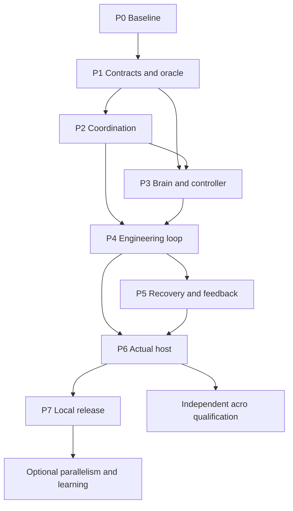

# Development roadmap

**Baseline: 2026-11-12.** This roadmap organizes future work around the coordinated factory. It is a dependency plan, not a promise of calendar dates or completed features. [Status](PROJECT_STATUS.md) records actual progress; [backlog](IMPLEMENTATION_BACKLOG.csv) owns task state; [detailed plan](IMPLEMENTATION_PLAN.md) supplies implementation instructions.

## Milestones and exits

| Milestone | Outcome | Work | Exit evidence | Current position |
|---|---|---|---|---|
| P0: Organized baseline | Organized baseline | WP-100 | Current architecture, traceability, cleanup, Copilot entry point and regression evidence. | Complete for planning/cleanup scope; coordinated product remains unimplemented. |
| P1: Executable contracts and evaluator | Executable contracts and evaluator | WP-110..WP-115 | Validated baseline/envelope/task/result schemas, transitions, v1 migration policy, fake host and protected behavioral fixtures. | Ready to start WP-110. |
| P2: Deterministic coordination | Deterministic coordination | WP-120..WP-126 | Transactional store, serial graph scheduler, materiality admission, job budgets, workspace ownership, check bridge and result admission. | Not started. |
| P3: Platform brain and intent control | Platform brain and intent control | WP-130..WP-135 | Profile/context/intake/reuse pipeline, brain task planner and independent drift checkpoints. | Not started; synthetic context can proceed without private sources. |
| P4: Complete multi-agent engineering loop | Complete multi-agent engineering loop | WP-140..WP-147 | Coder, independent test author, runner, reviewer, diagnosis, bounded repair/replanning and first full synthetic journey. | Not started; target of the first usable coordinated prototype. |
| P5: Recovery feedback and usability | Recovery feedback and usability | WP-150..WP-155 | Restart/cancel/revocation, feedback, readable status, combined faults and material-approval usability. | Not started. |
| P6: Installed host and first-environment acceptance | Installed host and first-environment acceptance | WP-160..WP-165 | Actual native adapter/role discovery/lifecycle, corp-local model-driven journeys, independent acceptance and measured operating limits. | Not started; real host and sources resolved only at the relevant boundary. |
| P7: Qualified local release and contribution preparation | Qualified local release and contribution preparation | WP-170..WP-174 | Verified docs, exact-effect boundary, contribution bundle and local release candidate; actual submission separately scoped. | Not started; WP-174 deferred until the actual contribution route is selected. |
| P8: Independent adaptations and optional improvements | Independent adaptations and optional improvements | WP-180..WP-184 | Acro-local qualification, measured parallelism and evaluated learning lifecycle. | Deferred; not prerequisites for P7. |

## Delivery strategy

Keep the existing assisted runner/source/evidence spine. Build a separate coordinated runtime and test it against a deterministic fake host before wiring an actual native host. Use distinct roles sequentially first; concurrency is a later measured optimization. Do not rebuild the factory as a hosted service or select a framework because a video uses it.

The logical critical path is:

The diagram groups milestones; the CSV graph defines exact work-package dependencies. Some context work can start once its P1 contracts exist while P2 progresses. Real host discovery can be investigated read-only earlier, but must not block executable source-neutral contracts or become an invented adapter implementation.

## First development sequence

1. Implement WP-110 as specified in [FIRST_TASK](development/FIRST_TASK.md); preserve v1 behavior.
2. Complete WP-111 and WP-112, then WP-113. WP-114 fake-host and WP-115 evaluator work can be independently selected after their prerequisites.
3. Build P2 coordination. In parallel only when deliberately delegated with disjoint ownership, develop P3 profiles/context/intake after their contracts exist.
4. Complete brain/controller and P4 roles. Demonstrate [FIRST_FACTORY_SLICE](specs/FIRST_FACTORY_SLICE.md) before adding a new UI or optional learning.
5. Harden recovery and select a real host adapter. Qualify installed, model-driven journeys in one target.
6. Complete P7 local release evidence. Adapt acro independently; do not export corp runtime knowledge to make it work.

## Gate rules

- Entry: prerequisites done, bounded deliverables/owned paths identified, tests and required real decisions available. A task can be designed with fake inputs until its live entry gate is reached.
- Exit: deliverables implemented, positive and known-bad cases observed, relevant regressions pass, independent review where required, limitations and next task recorded. A planned matrix row is not evidence.
- A source-neutral engineering success does not close P6. A metadata-discovery success does not establish model-driven delegation. A GitHub push does not close P7.
- A failed required check keeps the task open. Skips are recorded and excluded from pass claims. Material baseline/envelope changes route to the owner; equivalent repairs continue within allowance.
- Documentation and continuation records update in every coherent change, not only at the last milestone.

## Decisions needed at the right time

| Decision | Needed before | Useful work that can proceed now |
|---|---|---|
| Actual Copilot host/build and supported delegation/session mechanism | WP-160 | Contracts, fake host, scheduler, controller and synthetic journeys |
| Real SPARK supported interfaces and corp/acro source access | WP-163 / WP-180 | Fictional platform fixtures, retrieval integrity and compatibility logic |
| Genuine reviewer separation and effect mediation | Claimed independent live review / WP-164 | Explicit contracts, negative fixtures and honest assisted fallback |
| Trial/model/tool budget and data routes | Live inference/effects | Local deterministic checks and usage accounting |
| Platform destination, owner, support expectations and distribution terms | Actual release/submission | Local bundle preparation and reproducible source inventory |

If the actual native host cannot support the required unattended coordination, record the capability gap and choose a reviewable adapter alternative with the owner. Do not silently substitute a provider or call manual steps autonomous.

## Deferred scope and change control

P8 learning/parallelism does not block the core factory. Acro is a separate target and can be prioritized independently once its own prerequisites and operator context exist. A hosted SaaS, universal app generation, new UI, automatic production deployment and environment bridge are not in this baseline.

Any newly requested feature gets explicit intent/criterion impact, dependency and validation updates before it is added. Keep the first useful loop small; do not turn research breadth into implementation breadth.

## Latest checkpoint

WP-100 completed the repository/planning reorganization. Existing core behavior remains assisted v1. The next implementation task is WP-110. Fresh local checks collected 412 Python cases: 382 passed and 30 platform-dependent cases skipped, with no failures/errors. Planning/archive/link checks pass. Hosted CI results will be recorded after actual execution. See [validation history](VALIDATION_HISTORY.md); none of these checks prefill coordinated-runtime milestone acceptance.
