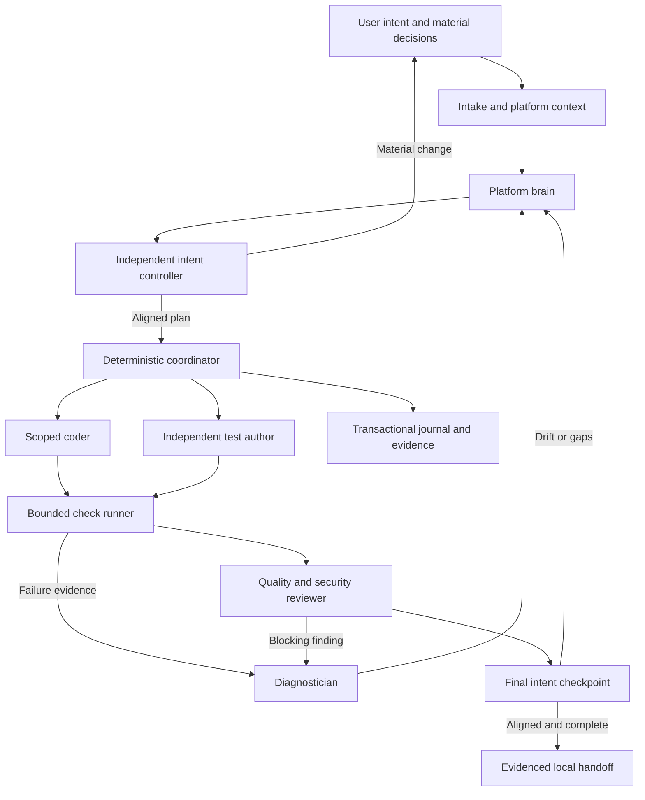
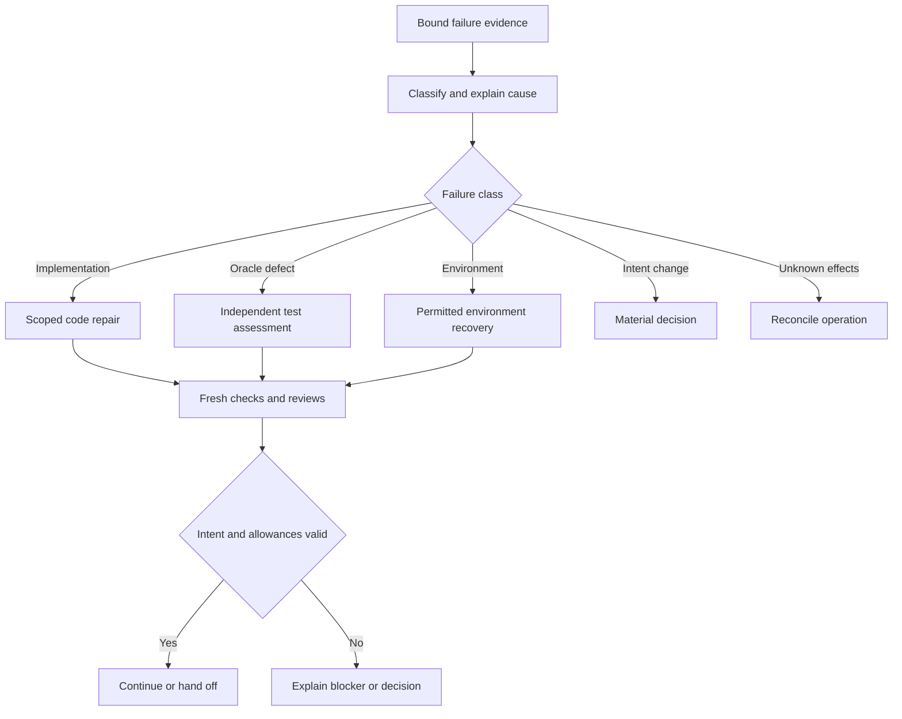

# Target factory architecture

**Status: design baseline, 2026-11-12.** The coordinated runtime is planned. The current assisted implementation is identified separately below. This document adopts the owner's requested multi-agent architecture; the earlier one-agent target is superseded as the destination.

## Product flow and ownership

The user owns the desired outcome, exclusions and domain acceptance. A platform-aware brain develops and revises the technical plan. An independent intent controller evaluates whether proposed work and results still satisfy that outcome. A deterministic coordinator admits tasks, enforces dependencies/allowances/evidence rules, and drives coding, testing, review, diagnosis and recovery. The native host provides the actual reasoning/tools/identity/isolation capabilities that have been selected and observed.

The diagram describes responsibilities, not an unrestricted peer-to-peer conversation mesh. Workers communicate through typed task/results and evidence records. The test runner is deterministic execution; it does not need its own LLM call. Distinct agents initially run sequentially. Parallel task fan-out is deferred until measured benefit and actual ownership/isolation are demonstrated.

## Existing implementation to reuse

| Existing surface | What it supplies | Limit |
|---|---|---|
| `plugins/sparkforge/scripts/factory.py` | Strict v1 spec validation, SQLite job/events, reservations, real bounded checks, candidate and review binding | Assisted exact-spec manual decisions; no agent scheduler or authenticated authority |
| `plugins/sparkforge/scripts/knowledge.py` | Verified selected snapshot bytes, bounded excerpts and citations | Lexical candidate lookup; no live permission/freshness/semantic completeness guarantee |
| Native agent and skill | Source-aware intake, reuse/spec/check/review/repair guidance | Host/operator coordinates the flow; one shipped agent/skill |
| Package builder and tests | Owned inventory, relocation and structural profiles | No installed-host or corp/acro acceptance |
| Host/storage tools | Narrow record consistency and disposable observations | Not production qualification or an enforcement service |

Do not change v1 spec or journal meaning during a planning refactor. Add the coordinated runtime alongside it. Existing assisted jobs remain readable/runnable through their existing interfaces. Any later shared-runner extraction gets explicit compatibility tests; do not generate synthetic operator approvals merely to use the old entry point.

## Three control artifacts

1. **IntentBaseline:** user outcome, audience, supported component, behavioral criteria, exclusions and material constraints. Changes need an explicit intent delta and the appropriate user decision.
2. **ExecutionPlan plus ExecutionEnvelope:** plan contains technical tasks/dependencies/ownership/checks/reviewer barriers; envelope grants bounded tools/data/effects/resources in one environment. Equivalent plan changes inside the accepted envelope can proceed after controller/admission checks. Envelope expansion requires its actual authority owner.
3. **EvidenceBundle:** source/profile bindings, exact candidate, check receipts, current reviewer/controller verdicts, failures, usage and limitations. It establishes only the behavior actually observed.

An approved intent does not authorize arbitrary tools or deployment. A plan is not execution authority. A candidate does not accept itself. [Data/state](DATA_AND_STATE.md) and [human decisions](HUMAN_DECISIONS.md) define these contracts.

## Components and proposed module boundaries

| Component | Responsibility | Proposed destination |
|---|---|---|
| Contracts | Closed typed records, canonical binding, validation | `plugins/sparkforge/runtime/contracts.py` and schemas |
| Transition engine/store | Legal state changes, revisions, events, reservations and recovery | `runtime/transitions.py`, `runtime/store.py` |
| Coordinator/scheduler | Ready tasks, barriers, serial dispatch, repair routing | `runtime/coordinator.py`, `runtime/scheduler.py`, `runtime/repair.py` |
| Policy/budgets | Materiality/envelope membership and accumulated resource admission | `runtime/policy.py`, `runtime/budgets.py` |
| Host/dispatch | Capability discovery, task invocation, polling, cancellation and usage | `runtime/host.py`, `runtime/dispatch.py`, `runtime/hosts/` |
| Platform/context | Supported interfaces, selected knowledge, citations and reuse | `runtime/platform.py`, `runtime/context.py`, `runtime/reuse.py` |
| Brain/controller | Technical planning versus independent semantic alignment | `runtime/planning.py`, `runtime/replanning.py`, `runtime/intent_control.py` |
| Worker adapters | Coder, test author, reviewer and diagnostician context/results | `runtime/roles/` |
| Workspace/check adapters | Ownership, manifests and existing runner evidence | `runtime/workspace.py`, `runtime/checks.py` |
| Recovery/status/delivery | Reconciliation, readable progress, feedback and exact bundles | `runtime/recovery.py`, `runtime/status.py`, `runtime/delivery.py` |

These are design destinations, not files to create as empty scaffolding. Keep boundaries small and merge modules when actual cohesion warrants it. Record any justified adjustment in the plan/cycle.

## Agent separation and authority

The [agent contracts](AGENT_CONTRACTS.md) define permitted work. Brain can propose task changes; controller can reject drift but cannot edit intent to erase it; coder cannot write protected criteria; test author cannot grant release; runner cannot reinterpret expected outcomes; reviewer cannot refresh a stale opinion; diagnostician cannot widen permission; coordinator cannot authenticate a human from a worker string.

Actual independent review needs distinct execution context and a host-observable producer relationship. A different model is optional, not proof of independence. Separate prompts using the same model can still share correlated errors. Preserve independent behavioral evaluation and known-bad controls.

## Engineering and failure loop

The runtime preserves all failures, enforces no-progress and job-wide allowances, and checks semantic alignment after repair/replan. A timeout does not become a safe retry. Changing task IDs, agents or plan versions does not reset totals. A test defect requires independent assessment; the coder cannot delete a failing behavior to get green.

## Context and platform fit

Keep the brain informed through a versioned platform profile, selected wiki/repository sources, component inventory and actual implementation/tests. Retrieve context per task; do not pass the entire wiki or accumulated conversation to every agent. Expose stale/denied/partial sources and conflicting guidance. Bind decisions to sources; hashes establish bytes, not permission or current truth.

Use explicit REUSE / UPDATE_EXISTING / NEW_COMPONENT assessments with inspected candidates and rationale. A compatible supported component is preferable to unnecessary new infrastructure. A missing comparison stays NOT_ASSESSED and may need a question or narrower task rather than an invented source.

## Host and environment boundaries

Use a small [host adapter contract](../integration/HOST_ADAPTER.md) around capabilities actually available in the selected Copilot host. A deterministic fake enables P1-P5 development. Installed model execution, agent discovery, cancellation, identity/tool mediation and usage visibility require real P6 observations. If the host lacks a capability, report unsupported and propose a concrete alternative rather than inventing a launcher.

Each run belongs to exactly one environment. corp and acro have separate profiles, sources, credentials, workspaces, journals, model routes and acceptance records. Shared reviewed code may be distributed only as permitted. No live bridge, shared credential store or automatic knowledge/state synchronization is needed.

Runner argv, path validation and worktrees do not confine code. Existing runner processes inherit the caller environment and stop only the owned direct process; descendants and network/secret access need actual host/OS controls. Scope claims must match that reality.

## Release and improvements

Handoff contains exact code, behavioral evidence, review/controller outcomes, docs and limitations. Submission is a separately bound effect and outcome. Keep optional learning/parallelism outside the first release's critical path. Learned improvements remain inactive until independent evaluation and an exact promotion decision.
