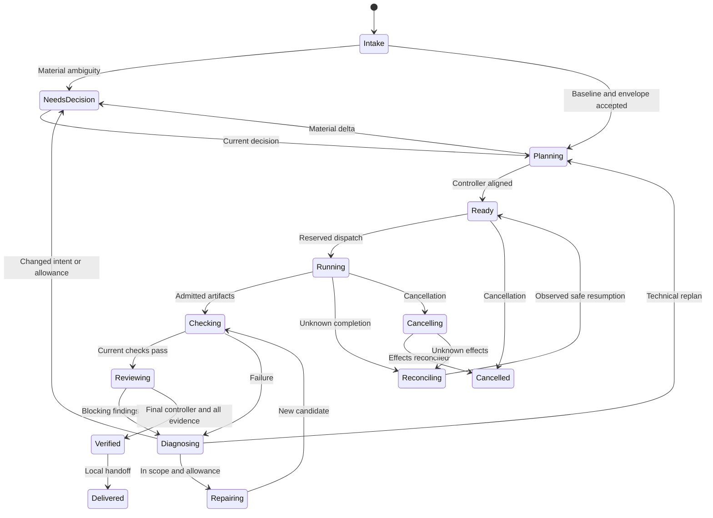

# Data contracts, state and compatibility

**Implemented coordinated contracts:** intent/envelope (WP-110), task/attempt/agent-result/finding/failure (WP-111), pure projection/command/event (WP-112). Plan, controller-verdict and evidence-bundle bodies remain planned. Current implemented `sparkforge.spec.v1` and assisted journals retain their own meaning.

## WP-110 public contract API

Import `plugins.sparkforge.runtime.contracts` through Python namespace packages; no initialization side effects or unused schema copies are needed. `validate_intent(value, supported_component_kinds=(...))` returns a detached `IntentBaseline`. The caller supplies a nonempty, unique vocabulary from its selected profile; the validator does not invent platform kinds or certify that profile. `validate_envelope(value, intent=baseline)` returns a detached `ExecutionEnvelope` after structural validation and exact intent ID/digest matching.

`parse_json(str_or_utf8_bytes)` rejects duplicate keys, malformed UTF-8/JSON, nonfinite numbers and excessive nesting. Pass its result to the record validator. `canonical_json(normalized_record)` uses the existing v1 canonicalization convention (sorted keys, compact JSON, unescaped Unicode, no nonfinite numbers); `record_digest(normalized_record)` is SHA-256 of those UTF-8 bytes. Every field and list order is bound. Validation does not silently trim text, normalize Unicode prose or omit authority-sensitive fields. `ContractError` supplies `code`, `path` and a bounded diagnostic without echoing input values.

| Contract choice | Implemented semantics |
|---|---|
| Identity and text | Closed fields; IDs are 1-80 ASCII letters/digits/`._-`, starting alphanumeric; revisions 1-1,000,000. Text is nonblank, at most 12,000 characters; tab/CR/LF allowed, other control/format/surrogate characters rejected. |
| Collections and serialization | At most 128 entries per ordinary list, two MiB UTF-8 per record and 32 JSON nesting levels. Duplicate criteria/source/reference/list identifiers fail. List order remains meaningful. Empty non-goals/constraints explicitly mean none; acceptance and source assumptions are nonempty. |
| Sources | Each assumption has ID, `known`/`unknown`/`unavailable`, statement, reason and references. References have opaque IDs and nullable revision/digest. Unknown bytes do not require invented hashes; even known references do not assert freshness or permission. |
| Environment/routes | Exactly one `LOCAL_DEVELOPMENT`, `CORP` or `ACRO`; profile, host and provider are opaque ID/positive-revision references, not credential-bearing URLs. Tools/effects are finite identifier lists, possibly empty. No credential or approval fields are accepted. Free text is not a secret scanner; callers must keep credentials out of all input. |
| Roots/paths | Roots carry ID, explicit `windows` or `posix` flavor and an absolute path. Windows uses uppercase drive plus backslashes; POSIX uses one leading slash. Volume/filesystem roots, UNC/devices, traversal, repeated/trailing separators, reserved Windows names, ADS, wildcard/8.3 aliases, Git internals and environment-secret paths fail. NFC spelling is required for paths, never silently converted. Up to 32 workspace roots (at least one) and 32 data roots (possibly none); duplicate IDs and lexical root aliases fail. |
| Relative identifiers | `relative_path(value)` accepts only canonical slash-separated relative paths, independently of the executing OS. Windows roots are never passed through the host's POSIX parser. Path components use the same portable restrictions; actual symlink/hardlink/network checks belong to later workspace admission. |
| Bounds | Positive integers only: job wall time <=604,800s; per-agent timeout <=86,400s; check timeout <=3,600s; agent/check attempts <=20; check output <=16 MiB; token caps <=1,000,000,000; other job/call/replan counts <=1,000,000. Per-agent/check allowances must fit job bounds. Disallowed work is represented by missing effects/tools, not unlimited/zero caps. |
| Usage/expiry | `unknown_usage` is `stop` or `reserve_maximum`, never assume-zero. `expires_at` is a real calendar UTC `YYYY-MM-DDTHH:MM:SSZ`; revocation contains both timestamp/reason or two nulls. Validation preserves expired/revoked proposals for later policy inspection; it neither probes the clock nor admits effects. |

These are structural proposal contracts, not a permission grant, materiality decision, source acquisition, authenticated producer identity, path sandbox or execution engine. TC-103/104 are exercised in `tests/test_runtime_contracts.py`; later admission must independently establish profile support, current authority, freshness, environment/path availability and accumulated allowances.

## WP-111 worker contract API

`plugins.sparkforge.runtime.agent_contracts` contains the cohesive worker-record family, sharing the strict WP-110 JSON/text/path/error helpers. The five closed records are `sparkforge.task.v1`, `sparkforge.attempt.v1`, `sparkforge.agent-result.v1`, `sparkforge.finding.v1` and `sparkforge.failure.v1`. No agent is installed or invoked by their validation.

| Function / record | Binding and semantics |
|---|---|
| `validate_task(value, intent=..., envelope=..., plan_sha=..., candidate_sha=...)` / `TaskAssignment` | Job/task/attempt/role plus intent/envelope/plan/candidate/input digests; input inventory digest recomputed. One matching environment/profile/host/provider, workspace ID and data-root subset; criteria exist in the baseline. Exact candidate writes cannot overlap protected path prefixes; no aliases/globs/absolute paths. Effects/tools/allowances cannot expand the envelope; deadline cannot exceed expiry. |
| Task result kinds | `intake: baseline_proposal`, `brain: plan_proposal`, `controller: controller_verdict`, `coder: candidate`, `test_author: tests`, `test_runner: check_report`, `reviewer: review`, `diagnostician: diagnosis`, `delivery: delivery_bundle`, `coordinator: coordination`. Only coder/test-author/delivery tasks may list candidate writes, with explicit `workspace_write`. Other role outputs use opaque artifact references, not arbitrary output filesystem paths. |
| `validate_attempt(value, task=...)` / `AgentAttempt` | Exact assignment digest/binding, durable operation key, bounded ordinal, separate host producer/observation, timestamps and observed usage. Reserved work cannot claim dispatch; accepted/running/cancel-requested are not completion. Unknown state preserves missing observation and usage rather than assuming no effects. |
| `validate_result(value, task=..., attempt=..., current_candidate_sha=..., prior_producers=(...))` / `AgentResult` | Exact assignment and current input-candidate binding, observed producer match, role-specific result kind, outcome, opaque artifact/evidence digests, claimed changed paths/output candidate, findings/failures, worker usage claim, uncertainty and next action. Host turn completion is necessary but never admits the claim as completed job evidence. Failed/cancelled/unknown host observations cannot become successful worker results. |
| Producer separation | Controller/test-author/reviewer results require caller-supplied relevant prior producer observations. Reusing the same stable host ID/context fails even if actor/session labels or host configuration revision change. These consistency checks cannot authenticate observations or establish that the caller supplied a complete prior-producer set; qualified host ingress remains mandatory. |
| `validate_finding` / `Finding` | Severity, failure category, bounded message/recommendation, optional canonical relative location, acceptance IDs and evidence refs. Enclosing result checks criterion membership and exact evidence identity/digest. Findings cannot grant approval. |
| `validate_failure` / `Failure` | Implementation/oracle/environment/intent/authority/stale/budget/unknown-effects/unknown cause; evidence or an explicit limitation; bounded correction suggestion. Unknown effects must suggest reconcile/stop, never an unobserved safe retry. A failed/blocked result must include a structured cause. |
| Usage | Host `observed_usage`, task `allowance` and worker `usage_claim` remain distinct. Reserved attempts must have unknown/null usage with a reason: neither positive reserved capacity nor an unobserved zero is measured consumption. Any known usage requires a host observation reference, including an otherwise unknown attempt. Known values are nonnegative integers <=10^12; observed overruns remain intact, not replaced by allowances or lower worker claims. Accounting/admission is WP-123. |

Arrays/text/identifiers use WP-110 limits; exact candidate path lists allow up to 512 entries. The functions normalize and revalidate supplied task/attempt structures, but only `validate_task` compares the complete intent/envelope/current-plan context. Callers must supply current authoritative observations, not let a worker substitute the comparison inputs. Actual graph membership, protected-control inventory, candidate bytes, authentic producer separation, current expiry/revocation and effect permission are later deterministic admission responsibilities. TC-105/106 are exercised by `tests/test_agent_envelopes.py`.

## Record ownership and binding

| Record | Required substance | Binding / owner |
|---|---|---|
| IntentBaseline | Outcome, audience, component kind, criterion IDs and behavior, non-goals, material constraints, source assumptions | Canonical digest and explicit user decision; user owns changes |
| ExecutionEnvelope | One environment/profile, permitted roots/tools/data/provider/effects, timeout/attempt/call limits, usage-unknown policy, expiry/revocation | Separate digest and actual operator/authority ingress |
| ExecutionPlan | Intent/envelope refs, task graph, role assignments, criterion coverage, controlled files/dependencies, check/reviewer inventory, plan rationale | Monotonic plan revision and previous-plan link; brain proposes, controller checks |
| TaskAssignment | Objective, role, dependencies, inputs, scope, acceptance, allowance, stop conditions | Job/task/attempt + intent/plan/envelope/input digests |
| AgentAttempt | Dispatch reservation, operation key, producer context, start/completion, observed usage | Host receipt + durable event identity; not a worker-supplied authority string |
| CandidateManifest | Controlled implementation/test/config/dependency file list, sizes/hashes and ownership | Exact candidate digest; include behaviorally relevant dependencies |
| CheckReceipt | Command, check/criterion IDs, exit/completion, output digest/limits, duration, uncertainty | Current candidate, task/attempt/check sequence and runner origin |
| Review/ControllerVerdict | Object reviewed, pre-inspection context, findings, criterion assessment and verdict | Current candidate/plan/evidence sequence; actual producer relationship |
| DecisionRequest/Decision | Material delta, alternatives, impact, exact object, responder/origin, time/revocation | Current target digest; editable JSON cannot authenticate its own origin |
| EffectIntent/Receipt | Destination, payload digest, requested effect, permitted identity, observed remote result | Durable operation key; unknown outcomes reconcile before retry |
| EvidenceBundle | Required inventory and admitted references, failures, skips, limitations, package binding | Completeness of current evidence only; not an independent grant of authority |

Use deterministic UTF-8 canonical JSON, stable field ordering and explicit finite numeric handling. Reject duplicate keys, unknown fields/versions, invalid enums, alias paths, missing required values and nonfinite numbers. A hash covers the full canonical record, not a selectively omitted constraint. Keep a clear distinction between user text and identifiers.

## Workflow guards and job states

`plugins.sparkforge.runtime.transitions` implements `initial_projection(kind, entity_id, context_sha, required_evidence)`, `validate_projection(value)` and `apply_command(projection, command, previous_event=None)`. These functions return detached `Projection`/`Event`/`TransitionResult` values and never create a store or dispatch. `TRANSITIONS` is the exact executable table for `job`, `task` and `attempt`; the diagram below remains a conceptual overview.

The closed schema family is `sparkforge.projection.v1`, `sparkforge.command.v1`, `sparkforge.event.v1`. Projections start at revision 1 with a fixed nonempty expected evidence-slot inventory, context digest, empty receipts/operations and no execution or stop claim. A context binds current intent, envelope, plan, candidate, inputs and evidence sequence as selected by the caller. Distinct failed, blocked, unknown/reconciling, cancelling and completed states preserve their meaning; full command events retain causes and opaque observation references, with the most recent bounded reason also in the projection.

| Command | Deterministic behavior |
|---|---|
| `advance` | Enforces the per-kind table and expected revision/current context. Block/failure/decision/diagnosis transitions need a cause. No shortcut from ready to running or from unexecuted work to completion. |
| `reserve` / `dispatch` | Reserves an unused operation identity before dispatch, one unresolved operation per projection. Dispatch requires that exact unused reservation; known, pending or uncertain IDs cannot be reused. Operation history is retained, capped at 128 per bounded pure projection; the guard rejects overflow explicitly. |
| `result` / `reconcile` | A result needs observed dispatch; orphaned reservations instead require explicit reconciliation. Known resolutions need observation references. Unknown outcomes remain unresolved. Confirmed completed reserved/unknown work can progress without redispatch; failures project to failed/diagnosing. `not_started` returns an unstopped job/task to ready and an attempt to failed, preserving its cause and historical dispatch flags. Stopped scope never becomes ready. Only a new operation identity may be reserved after proven no-start; the unused reservation cannot become successful execution. |
| `evidence` | Only expected slots with current context are accepted. Within one context, a slot is immutable except an identical repeat. A different receipt requires a new evidence context; stale review evidence cannot certify a rerun. These inputs must already be admitted by the caller, not raw worker claims. |
| `invalidate` | A reconciled job/task adopts a new context, retains old receipts as stale and requires new execution/evidence. It does not erase operation history, reset accounting or recycle an attempt. In-flight revocation/replanning is a later protocol, not silently handled as safe invalidation. |
| `cancel` / `cancel_ack` | Stop new work and retain every outstanding reservation, including one with no observed dispatch. A cancellation acknowledgement is not proof that work never ran or stopped. Explicit reconciliation must settle effects before cancelled completion; late results cannot reopen stopped scope. |

Verified/delivered/completed states require every fixed slot to have a current passing receipt, no unresolved operation, and a confirmed completed latest reservation with its dispatch/observed-execution flag. Earlier successful attempts or historical `has_dispatched=true` do not substitute for the latest required execution. Context invalidation also requires fresh execution and receipts. Operation flags and events retain attempted dispatch after `not_started`; no failed/unused attempt history is erased to manufacture success. Failure, skip, unknown or missing receipt is not a pass. The pure engine neither checks real authority nor proves the evidence bytes; policy/admission must do that before supplying commands.

Each event retains the complete normalized command, its full payload SHA-256, prior revision, resulting projection/digest and a deterministic event ID derived from entity kind/ID and command key. The store must look up the previous event by that identity: same key/payload returns the prior event with `replayed=true` and leaves the current projection unchanged, even if later cancellation occurred. Different payload/identity is a conflict; a revision behind the recorded event or equal revision with different bytes fails. Event/projection/command consistency is checked, not authenticated. WP-120 must persist key lookup, event and projection atomically and ensure history lineage; these pure functions cannot establish crash durability.

The pure WP-112 table now supplies the executable state guards. Later policy/dispatch/recovery tasks must connect authentic decisions, actual effects and cancellation/revocation to those guards. No implemented journal or live workflow is implied by this diagram.

## Store and command requirements

- Persist expected revision, command idempotency key, payload digest, event and projection atomically. Same key/same payload returns prior result; same key/different payload is a conflict.
- Reserve dispatch/check/external effects before calling the adapter. A reservation with no completion is unresolved, not automatically unused. Record observed usage once under the operation identity.
- Derive pending tasks from the validated graph, not model-selected arbitrary task IDs. One active task initially; no indefinite writer waits.
- Append historical attempts, plans, findings and decisions. A changed projection does not rewrite earlier evidence. A local SQLite journal remains same-privilege mutable; do not claim tamper-proof audit.
- Store role/session/producer receipts as observations. Authentication and per-role privilege enforcement depend on actual host capabilities.

## Invalidation and replay

| Change | Required effect |
|---|---|
| User behavior/non-goal/accepted constraint | New intent revision and decision; affected plan/results become stale |
| Envelope authority, environment, provider or data route | New envelope/authority; stop affected admissions and reassess in-flight work |
| Equivalent technical plan | New plan revision, controller verdict and dependency-impact analysis; preserve allowance totals |
| Controlled candidate/dependency bytes | Invalidate affected checks/reviews/controller outcome; recompute mandatory regression evidence |
| Check rerun on identical bytes | Advance evidence sequence; old review context cannot certify new evidence |
| Source/profile revision | Reassess decisions depending on those sources; no assumed freshness inheritance |
| Revocation/cancel | Stop new work; late results cannot resurrect superseded authority |
| Lost response/restart | Inspect reservation by operation key; reconcile, do not blindly replay |

Only explicitly proven-independent evidence can survive a plan revision. Default to invalidating affected evidence; do not optimize by attaching old findings to a newly fetched token. Hidden dependencies require a fuller candidate inventory or narrower claim.

## v1 coexistence and migrations

WP-113 implements `plugins.sparkforge.runtime.migrations` with these explicit APIs:

| API | Implemented behavior |
|---|---|
| `create_store(root, workspace=..., environment=...)` | Creates a new isolated directory and `coordinated.sqlite3` header, never adopting an existing directory. The header uses SQLite application ID `0x53464752`, user version 1 and one `runtime_metadata` row (family, store ID, environment, workspace). No job, decision, worker or projection is created. |
| `inspect_store(root)` | Reads recognized metadata only. Rejects assisted-v1 directories, foreign families/application IDs and unknown versions without changing them. |
| `legacy_reference(job_dir)` | Uses the unchanged `factory._state` on a read-only SQLite connection after explicit filesystem/journal preflight. Returns only job/spec/state/database bindings, environment, revision and unresolved-run presence under `assisted_v1_reference_only`; no decision, approval, raw spec or source text is imported. |
| `migrate_copy(source_root, destination_root)` | Holds a read transaction on the offline source, writes/verifies an exact `pre-migration.sqlite3` backup before the prepared working copy, and runs implemented trusted migration steps in one transaction. Source, environment, workspace and store identity remain unchanged; no replacement or activation occurs. Failure leaves inspectable owned preparation files and the preserved backup, not automatic cleanup or retry. |

The storage adapter reuses v1 directory/plain-file guards and the 32-MiB file bound without changing v1 code. Candidate workspace, source store and prepared destination cannot overlap. No coordinated store is created inside the immediate assisted job directory. Only owner-quiesced, local, plain DELETE-journal snapshots are supported: pre-existing journal/WAL/SHM files and WAL header bytes are rejected before SQLite can create sidecars. Preflight/read locks are not an OS security boundary against a same-privilege actor racing file replacement or changing modes; live/WAL/storage and power-failure qualification remain separate work.

Only schema version 1 ships, with no registered upgrade steps. Same-version copy preparation works now. Tests temporarily inject a trusted version-2 step to exercise backup-before-write, rollback and version rejection; that does not establish a released version 2 or convert any real operator state. Future version changes must register actual code paths and update validators with regression evidence. Migration SQL cannot accidentally commit, attach, change PRAGMAs or introduce savepoints; the transaction is checked after each step and before stamping the new version to catch SQLite automatic rollback. That guard is not a sandbox for trusted Python migration code.

Do not import `job.sqlite3` as a coordinated job or fabricate acceptance for it. Coordinated stores have their own schema/version and root. A v1 journal may be referenced read-only with a clearly scoped evidence class. It does not inherit accepted intent, envelope or host independence.

WP-125 must reuse the runner's mechanics without calling v1 `decide` as a fake operator. Options are a tested explicit adapter to genuinely accepted v1 jobs or a narrow shared execution extraction with both old and new admission front ends. Keep v1 public behavior and all applicable regression tests unchanged. Record the extraction decision before implementation.

Future store upgrades must retain the implemented version detection, verified backup/copy, single transaction, metadata validation and rollback rules. Reject unknown versions without modifying originals. The WP-120 journal/event tables are not implemented by this header. No automatic migration of real operator state occurs in synthetic tests.

## Observability and retention

Local runtime stores may contain source locators, paths, prompts and output. Default summaries should contain only the data needed to explain state/evidence. Retain raw output only under the selected envelope. Never commit real jobs, private profiles, model transcripts or mixed archives. Recovery backups and retention permissions remain target-local; Git is not the runtime store.
