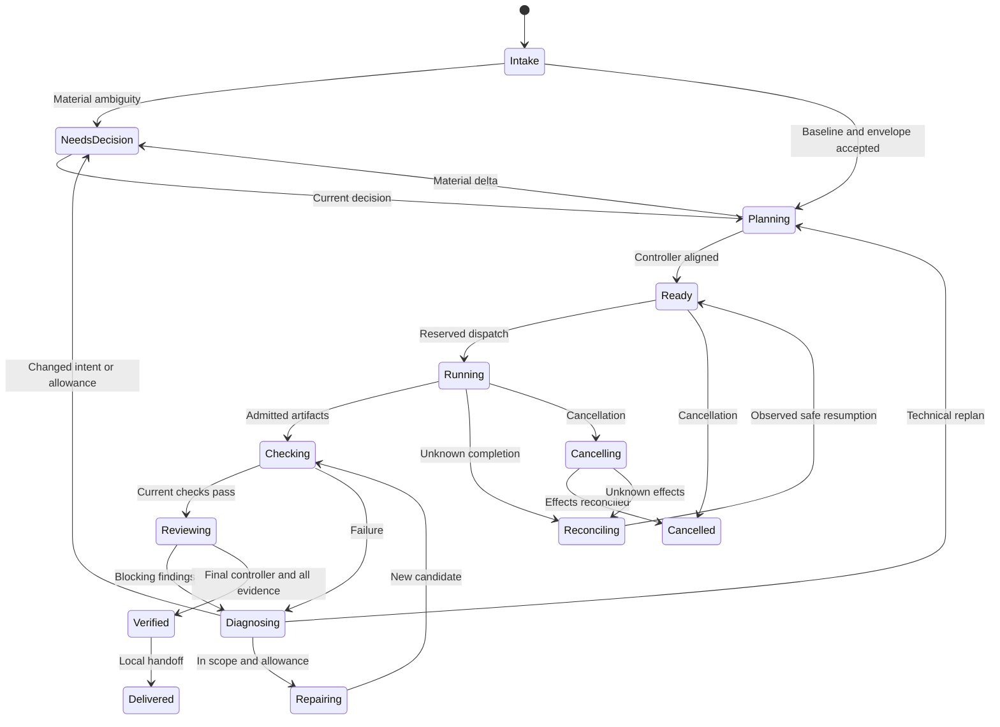

# Data contracts, state and compatibility

**Planned coordinated contract family:** `sparkforge.intent.v1`, `sparkforge.envelope.v1`, `sparkforge.plan.v1`, `sparkforge.task.v1`, `sparkforge.agent-result.v1`, `sparkforge.event.v1`, `sparkforge.controller-verdict.v1`, `sparkforge.evidence.v1`. These names are design targets for WP-110 onward, not parsers that exist today. Current implemented `sparkforge.spec.v1` and assisted journals retain their own meaning.

## Record ownership and binding

| Record | Required substance | Binding / owner |
|---|---|---|
| IntentBaseline | Outcome, audience, component kind, criterion IDs and behavior, non-goals, material constraints, source assumptions | Canonical digest and explicit user decision; user owns changes |
| ExecutionEnvelope | One environment/profile, permitted roots/tools/data/provider/effects, timeout/attempt/call limits, usage-unknown policy, expiry/revocation | Separate digest and actual operator/authority ingress |
| ExecutionPlan | Intent/envelope refs, task graph, role assignments, criterion coverage, controlled files/dependencies, check/reviewer inventory, plan rationale | Monotonic plan revision and previous-plan link; brain proposes, controller checks |
| TaskAssignment | Objective, role, dependencies, inputs, scope, acceptance, allowance, stop conditions | Job/task/attempt + intent/plan/envelope/input digests |
| AgentAttempt | Dispatch reservation, operation key, producer context, start/completion, observed usage | Host receipt + durable event identity; not a worker-supplied authority string |
| CandidateManifest | Controlled implementation/test/config/dependency file list, sizes/hashes and ownership | Exact candidate digest; include behaviorally relevant dependencies |
| CheckReceipt | Command, check/criterion IDs, exit/completion, output digest/limits, duration, uncertainty | Current candidate, task/attempt/check sequence and runner origin |
| Review/ControllerVerdict | Object reviewed, pre-inspection context, findings, criterion assessment and verdict | Current candidate/plan/evidence sequence; actual producer relationship |
| DecisionRequest/Decision | Material delta, alternatives, impact, exact object, responder/origin, time/revocation | Current target digest; editable JSON cannot authenticate its own origin |
| EffectIntent/Receipt | Destination, payload digest, requested effect, permitted identity, observed remote result | Durable operation key; unknown outcomes reconcile before retry |
| EvidenceBundle | Required inventory and admitted references, failures, skips, limitations, package binding | Completeness of current evidence only; not an independent grant of authority |

Use deterministic UTF-8 canonical JSON, stable field ordering and explicit finite numeric handling. Reject duplicate keys, unknown fields/versions, invalid enums, alias paths, missing required values and nonfinite numbers. A hash covers the full canonical record, not a selectively omitted constraint. Keep a clear distinction between user text and identifiers.

## Proposed job states

This diagram is conceptual; WP-112 defines the exact executable enum and transition table. Blocked and failed task projections preserve their cause without conflating terminal job failure, a retryable defect and unresolved effects. Cancellation/revocation stops new admission in every nonterminal state even where the diagram omits repetitive edges.

## Store and command requirements

- Persist expected revision, command idempotency key, payload digest, event and projection atomically. Same key/same payload returns prior result; same key/different payload is a conflict.
- Reserve dispatch/check/external effects before calling the adapter. A reservation with no completion is unresolved, not automatically unused. Record observed usage once under the operation identity.
- Derive pending tasks from the validated graph, not model-selected arbitrary task IDs. One active task initially; no indefinite writer waits.
- Append historical attempts, plans, findings and decisions. A changed projection does not rewrite earlier evidence. A local SQLite journal remains same-privilege mutable; do not claim tamper-proof audit.
- Store role/session/producer receipts as observations. Authentication and per-role privilege enforcement depend on actual host capabilities.

## Invalidation and replay

| Change | Required effect |
|---|---|
| User behavior/non-goal/accepted constraint | New intent revision and decision; affected plan/results become stale |
| Envelope authority, environment, provider or data route | New envelope/authority; stop affected admissions and reassess in-flight work |
| Equivalent technical plan | New plan revision, controller verdict and dependency-impact analysis; preserve allowance totals |
| Controlled candidate/dependency bytes | Invalidate affected checks/reviews/controller outcome; recompute mandatory regression evidence |
| Check rerun on identical bytes | Advance evidence sequence; old review context cannot certify new evidence |
| Source/profile revision | Reassess decisions depending on those sources; no assumed freshness inheritance |
| Revocation/cancel | Stop new work; late results cannot resurrect superseded authority |
| Lost response/restart | Inspect reservation by operation key; reconcile, do not blindly replay |

Only explicitly proven-independent evidence can survive a plan revision. Default to invalidating affected evidence; do not optimize by attaching old findings to a newly fetched token. Hidden dependencies require a fuller candidate inventory or narrower claim.

## v1 coexistence and migrations

Do not import `job.sqlite3` as a coordinated job or fabricate acceptance for it. Coordinated stores have their own schema/version and root. A v1 journal may be referenced read-only with a clearly scoped evidence class. It does not inherit accepted intent, envelope or host independence.

WP-125 must reuse the runner's mechanics without calling v1 `decide` as a fake operator. Options are a tested explicit adapter to genuinely accepted v1 jobs or a narrow shared execution extraction with both old and new admission front ends. Keep v1 public behavior and all applicable regression tests unchanged. Record the extraction decision before implementation.

Future store upgrades need explicit version detection, a verified backup/copy, a transaction or new-store migration, validation and rollback. Reject unknown versions without modifying originals. No automatic migration of real operator state in synthetic tests.

## Observability and retention

Local runtime stores may contain source locators, paths, prompts and output. Default summaries should contain only the data needed to explain state/evidence. Retain raw output only under the selected envelope. Never commit real jobs, private profiles, model transcripts or mixed archives. Recovery backups and retention permissions remain target-local; Git is not the runtime store.
