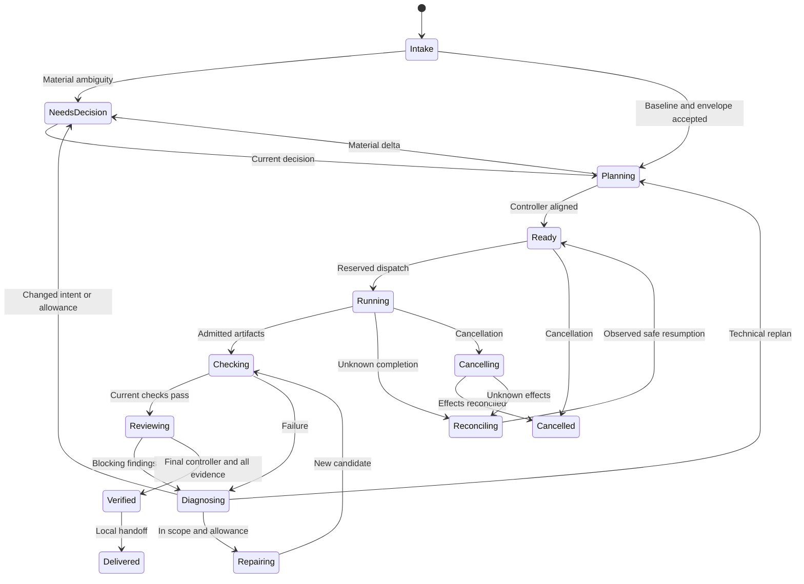

# Data contracts, state and compatibility

**Implemented coordinated contracts:** intent/envelope (WP-110), task/attempt/agent-result/finding/failure (WP-111), pure projection/command/event (WP-112). Plan, controller-verdict and evidence-bundle bodies remain planned. Current implemented `sparkforge.spec.v1` and assisted journals retain their own meaning.

## WP-110 public contract API

Import `plugins.sparkforge.runtime.contracts` through Python namespace packages; no initialization side effects or unused schema copies are needed. `validate_intent(value, supported_component_kinds=(...))` returns a detached `IntentBaseline`. The caller supplies a nonempty, unique vocabulary from its selected profile; the validator does not invent platform kinds or certify that profile. `validate_envelope(value, intent=baseline)` returns a detached `ExecutionEnvelope` after structural validation and exact intent ID/digest matching.

`parse_json(str_or_utf8_bytes)` rejects duplicate keys, malformed UTF-8/JSON, nonfinite numbers and excessive nesting. Pass its result to the record validator. `canonical_json(normalized_record)` uses the existing v1 canonicalization convention (sorted keys, compact JSON, unescaped Unicode, no nonfinite numbers); `record_digest(normalized_record)` is SHA-256 of those UTF-8 bytes. Every field and list order is bound. Validation does not silently trim text, normalize Unicode prose or omit authority-sensitive fields. `ContractError` supplies `code`, `path` and a bounded diagnostic without echoing input values.

| Contract choice | Implemented semantics |
|---|---|
| Identity and text | Closed fields; IDs are 1-80 ASCII letters/digits/`._-`, starting alphanumeric; revisions 1-1,000,000. Text is nonblank, at most 12,000 characters; tab/CR/LF allowed, other control/format/surrogate characters rejected. |
| Collections and serialization | At most 128 entries per ordinary list, two MiB UTF-8 per record and 32 JSON nesting levels. Duplicate criteria/source/reference/list identifiers fail. List order remains meaningful. Empty non-goals/constraints explicitly mean none; acceptance and source assumptions are nonempty. |
| Sources | Each assumption has ID, `known`/`unknown`/`unavailable`, statement, reason and references. References have opaque IDs and nullable revision/digest. Unknown bytes do not require invented hashes; even known references do not assert freshness or permission. |
| Environment/routes | Exactly one `LOCAL_DEVELOPMENT`, `CORP` or `ACRO`; profile, host and provider are opaque ID/positive-revision references, not credential-bearing URLs. Tools/effects are finite identifier lists, possibly empty. No credential or approval fields are accepted. Free text is not a secret scanner; callers must keep credentials out of all input. |
| Roots/paths | Roots carry ID, explicit `windows` or `posix` flavor and an absolute path. Windows uses uppercase drive plus backslashes; POSIX uses one leading slash. Volume/filesystem roots, UNC/devices, traversal, repeated/trailing separators, reserved Windows names, ADS, wildcard/8.3 aliases, Git internals and environment-secret paths fail. NFC spelling is required for paths, never silently converted. Up to 32 workspace roots (at least one) and 32 data roots (possibly none); duplicate IDs and lexical root aliases fail. |
| Relative identifiers | `relative_path(value)` accepts only canonical slash-separated relative paths, independently of the executing OS. Windows roots are never passed through the host's POSIX parser. Path components use the same portable restrictions; actual symlink/hardlink/network checks belong to later workspace admission. |
| Bounds | Positive integers only: job wall time <=604,800s; per-agent timeout <=86,400s; check timeout <=3,600s; agent/check attempts <=20; check output <=16 MiB; token caps <=1,000,000,000; other job/call/replan counts <=1,000,000. Per-agent/check allowances must fit job bounds. Disallowed work is represented by missing effects/tools, not unlimited/zero caps. |
| Usage/expiry | `unknown_usage` is `stop` or `reserve_maximum`, never assume-zero. `expires_at` is a real calendar UTC `YYYY-MM-DDTHH:MM:SSZ`; revocation contains both timestamp/reason or two nulls. Validation preserves expired/revoked proposals for later policy inspection; it neither probes the clock nor admits effects. |

These are structural proposal contracts, not a permission grant, materiality decision, source acquisition, authenticated producer identity, path sandbox or execution engine. TC-103/104 are exercised in `tests/test_runtime_contracts.py`; later admission must independently establish profile support, current authority, freshness, environment/path availability and accumulated allowances.

## WP-111 worker contract API

`plugins.sparkforge.runtime.agent_contracts` contains the cohesive worker-record family, sharing the strict WP-110 JSON/text/path/error helpers. The five closed records are `sparkforge.task.v1`, `sparkforge.attempt.v1`, `sparkforge.agent-result.v1`, `sparkforge.finding.v1` and `sparkforge.failure.v1`. No agent is installed or invoked by their validation.

| Function / record | Binding and semantics |
|---|---|
| `validate_task(value, intent=..., envelope=..., plan_sha=..., candidate_sha=...)` / `TaskAssignment` | Job/task/attempt/role plus intent/envelope/plan/candidate/input digests; input inventory digest recomputed. One matching environment/profile/host/provider, workspace ID and data-root subset; criteria exist in the baseline. Exact candidate writes cannot overlap protected path prefixes; no aliases/globs/absolute paths. Effects/tools/allowances cannot expand the envelope; deadline cannot exceed expiry. |
| Task result kinds | `intake: baseline_proposal`, `brain: plan_proposal`, `controller: controller_verdict`, `coder: candidate`, `test_author: tests`, `test_runner: check_report`, `reviewer: review`, `diagnostician: diagnosis`, `delivery: delivery_bundle`, `coordinator: coordination`. Only coder/test-author/delivery tasks may list candidate writes, with explicit `workspace_write`. Other role outputs use opaque artifact references, not arbitrary output filesystem paths. |
| `validate_attempt(value, task=...)` / `AgentAttempt` | Exact assignment digest/binding, durable operation key, bounded ordinal, separate host producer/observation, timestamps and observed usage. Reserved work cannot claim dispatch; accepted/running/cancel-requested are not completion. Unknown state preserves missing observation and usage rather than assuming no effects. |
| `validate_result(value, task=..., attempt=..., current_candidate_sha=..., prior_producers=(...))` / `AgentResult` | Exact assignment and current input-candidate binding, observed producer match, role-specific result kind, outcome, opaque artifact/evidence digests, claimed changed paths/output candidate, findings/failures, worker usage claim, uncertainty and next action. Host turn completion is necessary but never admits the claim as completed job evidence. Failed/cancelled/unknown host observations cannot become successful worker results. |
| Producer separation | Controller/test-author/reviewer results require caller-supplied relevant prior producer observations. Reusing the same stable host ID/context fails even if actor/session labels or host configuration revision change. These consistency checks cannot authenticate observations or establish that the caller supplied a complete prior-producer set; qualified host ingress remains mandatory. |
| `validate_finding` / `Finding` | Severity, failure category, bounded message/recommendation, optional canonical relative location, acceptance IDs and evidence refs. Enclosing result checks criterion membership and exact evidence identity/digest. Findings cannot grant approval. |
| `validate_failure` / `Failure` | Implementation/oracle/environment/intent/authority/stale/budget/unknown-effects/unknown cause; evidence or an explicit limitation; bounded correction suggestion. Unknown effects must suggest reconcile/stop, never an unobserved safe retry. A failed/blocked result must include a structured cause. |
| Usage | Host `observed_usage`, task `allowance` and worker `usage_claim` remain distinct. Reserved attempts must have unknown/null usage with a reason: neither positive reserved capacity nor an unobserved zero is measured consumption. Any known usage requires a host observation reference, including an otherwise unknown attempt. Known values are nonnegative integers <=10^12; observed overruns remain intact, not replaced by allowances or lower worker claims. Accounting/admission is WP-123. |

Arrays/text/identifiers use WP-110 limits; exact candidate path lists allow up to 512 entries. The functions normalize and revalidate supplied task/attempt structures, but only `validate_task` compares the complete intent/envelope/current-plan context. Callers must supply current authoritative observations, not let a worker substitute the comparison inputs. Actual graph membership, protected-control inventory, candidate bytes, authentic producer separation, current expiry/revocation and effect permission are later deterministic admission responsibilities. TC-105/106 are exercised by `tests/test_agent_envelopes.py`.

## Record ownership and binding

| Record | Required substance | Binding / owner |
|---|---|---|
| IntentBaseline | Outcome, audience, component kind, criterion IDs and behavior, non-goals, material constraints, source assumptions | Canonical digest and explicit user decision; user owns changes |
| ExecutionEnvelope | One environment/profile, permitted roots/tools/data/provider/effects, timeout/attempt/call limits, usage-unknown policy, expiry/revocation | Separate digest and actual operator/authority ingress |
| ExecutionPlan | Intent/envelope refs, task graph, role assignments, criterion coverage, controlled files/dependencies, check/reviewer inventory, plan rationale | Monotonic plan revision and previous-plan link; brain proposes, controller checks |
| TaskAssignment | Objective, role, dependencies, inputs, scope, acceptance, allowance, stop conditions | Job/task/attempt + intent/plan/envelope/input digests |
| AgentAttempt | Dispatch reservation, operation key, producer context, start/completion, observed usage | Host receipt + durable event identity; not a worker-supplied authority string |
| CandidateManifest | Controlled implementation/test/config/dependency file list, sizes/hashes and ownership | Exact candidate digest; include behaviorally relevant dependencies |
| CheckReceipt | Command, check/criterion IDs, exit/completion, output digest/limits, duration, uncertainty | Current candidate, task/attempt/check sequence and runner origin |
| Review/ControllerVerdict | Object reviewed, pre-inspection context, findings, criterion assessment and verdict | Current candidate/plan/evidence sequence; actual producer relationship |
| DecisionRequest/Decision | Material delta, alternatives, impact, exact object, responder/origin, time/revocation | Current target digest; editable JSON cannot authenticate its own origin |
| EffectIntent/Receipt | Destination, payload digest, requested effect, permitted identity, observed remote result | Durable operation key; unknown outcomes reconcile before retry |
| EvidenceBundle | Required inventory and admitted references, failures, skips, limitations, package binding | Completeness of current evidence only; not an independent grant of authority |

Use deterministic UTF-8 canonical JSON, stable field ordering and explicit finite numeric handling. Reject duplicate keys, unknown fields/versions, invalid enums, alias paths, missing required values and nonfinite numbers. A hash covers the full canonical record, not a selectively omitted constraint. Keep a clear distinction between user text and identifiers.

## Workflow guards and job states

`plugins.sparkforge.runtime.transitions` implements `initial_projection(kind, entity_id, context_sha, required_evidence)`, `validate_projection(value)` and `apply_command(projection, command, previous_event=None)`. These functions return detached `Projection`/`Event`/`TransitionResult` values and never create a store or dispatch. `TRANSITIONS` is the exact executable table for `job`, `task` and `attempt`; the diagram below remains a conceptual overview.

The closed schema family is `sparkforge.projection.v1`, `sparkforge.command.v1`, `sparkforge.event.v1`. Projections start at revision 1 with a fixed nonempty expected evidence-slot inventory, context digest, empty receipts/operations and no execution or stop claim. A context binds current intent, envelope, plan, candidate, inputs and evidence sequence as selected by the caller. Distinct failed, blocked, unknown/reconciling, cancelling and completed states preserve their meaning; full command events retain causes and opaque observation references, with the most recent bounded reason also in the projection.

| Command | Deterministic behavior |
|---|---|
| `advance` | Enforces the per-kind table and expected revision/current context. Block/failure/decision/diagnosis transitions need a cause. No shortcut from ready to running or from unexecuted work to completion. |
| `reserve` / `dispatch` | Reserves an unused operation identity before dispatch, one unresolved operation per projection. Dispatch requires that exact unused reservation; known, pending or uncertain IDs cannot be reused. Operation history is retained, capped at 128 per bounded pure projection; the guard rejects overflow explicitly. |
| `result` / `reconcile` | A result needs observed dispatch; orphaned reservations instead require explicit reconciliation. Known resolutions need observation references. Unknown outcomes remain unresolved. Confirmed completed reserved/unknown work can progress without redispatch; failures project to failed/diagnosing. `not_started` returns an unstopped job/task to ready and an attempt to failed, preserving its cause and historical dispatch flags. Stopped scope never becomes ready. Only a new operation identity may be reserved after proven no-start; the unused reservation cannot become successful execution. |
| `evidence` | Only expected slots with current context are accepted. Within one context, a slot is immutable except an identical repeat. A different receipt requires a new evidence context; stale review evidence cannot certify a rerun. These inputs must already be admitted by the caller, not raw worker claims. |
| `invalidate` | A reconciled job/task adopts a new context, retains old receipts as stale and requires new execution/evidence. It does not erase operation history, reset accounting or recycle an attempt. In-flight revocation/replanning is a later protocol, not silently handled as safe invalidation. |
| `cancel` / `cancel_ack` | Stop new work and retain every outstanding reservation, including one with no observed dispatch. A cancellation acknowledgement is not proof that work never ran or stopped. Explicit reconciliation must settle effects before cancelled completion; late results cannot reopen stopped scope. |

Verified/delivered/completed states require every fixed slot to have a current passing receipt, no unresolved operation, and a confirmed completed latest reservation with its dispatch/observed-execution flag. Earlier successful attempts or historical `has_dispatched=true` do not substitute for the latest required execution. Context invalidation also requires fresh execution and receipts. Operation flags and events retain attempted dispatch after `not_started`; no failed/unused attempt history is erased to manufacture success. Failure, skip, unknown or missing receipt is not a pass. The pure engine neither checks real authority nor proves the evidence bytes; policy/admission must do that before supplying commands.

Each event retains the complete normalized command, its full payload SHA-256, prior revision, resulting projection/digest and a deterministic event ID derived from entity kind/ID and command key. The store must look up the previous event by that identity: same key/payload returns the prior event with `replayed=true` and leaves the current projection unchanged, even if later cancellation occurred. Different payload/identity is a conflict; a revision behind the recorded event or equal revision with different bytes fails. Event/projection/command consistency is checked, not authenticated. WP-120 must persist key lookup, event and projection atomically and ensure history lineage; these pure functions cannot establish crash durability.

The pure WP-112 table now supplies the executable state guards. Later policy/dispatch/recovery tasks must connect authentic decisions, actual effects and cancellation/revocation to those guards. No implemented journal or live workflow is implied by this diagram.

## Store and command requirements

- Persist expected revision, command idempotency key, payload digest, event and projection atomically. Same key/same payload returns prior result; same key/different payload is a conflict.
- Reserve dispatch/check/external effects before calling the adapter. A reservation with no completion is unresolved, not automatically unused. Record observed usage once under the operation identity.
- Derive pending tasks from the validated graph, not model-selected arbitrary task IDs. One active task initially; no indefinite writer waits.
- Append historical attempts, plans, findings and decisions. A changed projection does not rewrite earlier evidence. A local SQLite journal remains same-privilege mutable; do not claim tamper-proof audit.
- Store role/session/producer receipts as observations. Authentication and per-role privilege enforcement depend on actual host capabilities.

## WP-120 prepared storage and recovery contract

**Implemented by WP-120 after the original preparation.** The following contract remains the design basis; the [implemented API and limits](#implemented-wp-120-api-and-boundaries) identify the actual supplied behavior. This journal is not a scheduler, host invocation, authenticated approval ingress or budget policy.

### Store scope and schema evolution

Start with one job per environment-local coordinated store and the existing owned-directory/plain-file boundaries. Do not adopt assisted `job.sqlite3` or infer approval from a stored intent/envelope. Preserve the SQLite application ID/family and store/environment/workspace identity. Keep the existing 32-MiB inspection/copy limit and two-MiB canonical-record limit; exceeding them must fail explicitly, not truncate or prune history.

Coordinated schema version 2 is implemented, distinct from assisted-v1 and unchanged P1 JSON record versions. New v2 stores and the explicit v1-header-to-v2 migration share one tested initializer. Upgrade only through `migrations.migrate_copy`: verify backup before writes, create/validate tables in the active transaction, stamp version 2 last, and never activate or overwrite the original automatically. Unknown versions, missing steps, identity changes and interrupted upgrades fail closed. The older temporary v2 test injection has been replaced by the real upgrade; future-version fault fixtures now target version 3.

Use local SQLite DELETE-journal mode, `foreign_keys=ON`, `synchronous=FULL` and explicit transactions. Initially use the existing fail-fast writer policy (`timeout=0`); return a typed busy result instead of unbounded waits/retry loops. WAL and remote storage remain unsupported unless separately implemented/qualified. Migration/snapshot inspection remains offline/read-only; runtime crash recovery needs its own explicit owned-store opener rather than weakening the existing legacy inspector's sidecar refusal.

### Required persistent records

The table names below are proposed implementation names. Keys, ownership and atomicity are required invariants, not a second unchecked schema copy.

| Table | Required identity/content and invariant |
|---|---|
| `runtime_metadata` and `job` | Existing store identity plus exactly one job ID and immutable initial intent/envelope bindings. Job creation starts at intake; it is not acceptance or execution permission. Enforce environment/workspace consistency. |
| `records` | Immutable canonical body/digest, schema, kind, stable ID and revision. Unique kind/ID/revision and content binding; same identity with different bytes is a conflict. Persist intent/envelope, assignments, attempts/results/findings, observations and required evidence references without rewriting old revisions. Until full plan/evidence schemas exist, store their explicitly typed digest references as unassessed artifacts, not arbitrary blobs admitted as plans or success evidence. |
| `entities` | Key `(kind, entity_id)` for job/task/attempt, parent/job association, immutable initial projection reference, current revision/body/digest and latest event reference. Projected columns must match the validated body. Initialization is revision 1; transitions cannot silently create missing entities. |
| `commands` | Store/job-scoped unique command key, operation type, exact normalized request digest, target identity, committed result/digest and optional transition event ID. The digest includes the complete command and associated record/reservation bindings. Retain bootstrap/register command receipts too; duplicate initialization cannot create another job/entity. |
| `events` | Unique deterministic event ID, unique entity/after-revision and command reference, prior projection digest/revision, complete validated P1 event body/digest. Append-only. Events start after the immutable revision-1 initialization snapshot; do not fabricate a P1 revision-0 transition. |
| `reservations` | Store/job-scoped unique operation key, one authoritative owning entity/attempt, exact assignment/context/effect-scope bindings, reserved allowance reference, current state, historical dispatch-attempt flag and latest event/observation references. A key cannot move to another owner or payload. Parent projections reference the reservation rather than duplicating an external invocation. Consumption stays in observation records, never copied from the allowance hold. |

Use foreign keys/uniqueness constraints plus P1 validation; SQL indexes are not substitutes for canonical digest/binding checks. Source and producer claims stay labeled, including `scripted_fake` and unknown usage. Persist observation IDs/digests once per operation; conflicting observations with the same identity fail, while later observations append history. WP-123 will define accounting: WP-120 must retain unknown consumption and actual overruns without summing guesses, resetting totals or interpreting allowance as use.

For transition requests, the store's full request digest additionally binds associated record/reservation input; the P1 event's `command_sha` still hashes its exact inner `Command`. Persist and validate both identities rather than replacing one with the other. Bootstrap/register requests have durable command receipts and immutable initial records, not invented transition events.

### Atomic command application and persistent idempotency

The planned public surface is a minimal initialize/register operation, a bounded command-application operation, read-only status/history, and an explicit recovery operation. Exact function names may follow the implementation's cohesion; no caller supplies arbitrary SQL.

1. Validate bounded input and canonical request digest before effects. Open only the selected recognized v2 store; no host, process or external tool call occurs inside these APIs.
2. `BEGIN IMMEDIATE`; look up the durable command key **before** rejecting a stale expected revision. Same key/same full payload returns the previously committed event/result with replay indicated and the current projection, without writes or revision increments. It must not restore an older projection over later cancellation/invalidation. Same key/different payload or entity is an explicit conflict.
3. For a new key, load and verify the current entity projection, initial/history bindings and expected revision. Validate context, immutable input references and reservation ownership. Reuse corrected `transitions.apply_command` rather than implementing a second state machine.
4. In the **same transaction**, append referenced immutable records/observations, insert command receipt and event, update the projection with `WHERE revision = expected_revision`, and insert/update its reservation. Require exactly one projection row updated. Unique event/key/operation conflicts or any rejected record roll back the entire set. No `INSERT OR REPLACE` or partial-success fallback.
5. Commit before acknowledging success. A failure at any earlier write must leave either the complete old state or the complete new committed state, never a partial event/projection/reservation. If commit acknowledgement is lost or uncertain, return an explicit unresolved persistence result and inspect the same durable key on reopen; do not assume rollback or generate another key.

The current one-entity transition contract is the minimum WP-120 boundary. A caller must not split one effect reservation and its owning event/projection across transactions. If a later coordinator needs atomic parent/child advancement, add a bounded batch with all expected revisions validated and committed together, rather than inventing that multi-entity scheduler inside WP-120.

### Dispatch boundary and recovery rules

The journal never launches the host. A dispatcher must commit the reservation and its dispatch-attempt transition before calling the adapter. That marker records intent/attempt to dispatch, not proof execution occurred. On restart, **every** nonterminal reservation is inspected by its original operation key; a timestamp, missing response, cancel acknowledgement or absent usage is not proof nothing happened.

| Crash/observation boundary | Required reconstruction and next action |
|---|---|
| Before a local transaction commits | SQLite rolls back the incomplete transaction; no partial command/event/projection/reservation is admitted. Retry of that local storage command uses the same key. No host call was authorized by an uncommitted reservation. |
| After reservation/dispatch commit, before or during a host call, or before its response is saved | Preserve reserved/dispatched/unknown state and allowance. The caller cannot distinguish these crash positions reliably from missing local completion; reconcile the same key. Do not redispatch it or allocate a new key to evade uncertainty. |
| After a completion transaction commits but its reply is lost | Read the committed command receipt; return replay without duplicate events, consumption or host invocation. |
| Reconciliation reports unknown or only cancel acknowledgement | Leave effects unresolved and stop new conflicting work. Persist any genuinely observed consumption with its reference; unknown usage remains null, not zero. |
| Reconciliation proves `not_started` | Append the observation, close that reservation as unused, preserve historical dispatch/command records and do not claim successful execution. Unstopped work may later receive a new identity within policy/allowance; stopped work remains stopped. |
| Reconciliation confirms completed/failed/stopped | Persist the exact observation and event atomically. Apply corrected P1 transitions; completion still requires the latest reserved operation to have completed plus all current required evidence. Known failure cannot become a pass, and late completion cannot reopen revoked/cancelled scope. |
| Corrupt/missing record, digest mismatch, divergent projection/event lineage or unknown schema | Return explicit invalid/unavailable state; do not skip events, invent empty success, rewrite history or dispatch. Preserve the store for diagnosis. |

Read-only status must reconstruct the same projection, latest observations and unresolved reservation inventory after process restart. Verify initial snapshot plus contiguous event revisions, before/after hashes, command/payload identity and matching reservation projection. Replaying a journal is computation only: never invoke an adapter while replaying events. Projection rebuild is not silent corruption repair; any repair must first verify complete history and preserve the original.

SQLite transaction recovery and external-effect reconciliation are separate. A read-only inspector that encounters a hot rollback journal reports recovery required. An explicit recovery opener may allow SQLite's own rollback recovery only for the already-owned, recognized coordinated v2 store under its locking policy; it must not delete journals manually, recover an assisted store, accept unknown schemas or convert pending host operations to unused. Test this with owned child processes; process-crash tests do not establish power-loss, remote-filesystem or hardware durability.

### Required WP-120 exit cases

Implement these under TC-115/116 before marking WP-120 done:

- Round-trip all supported record families/references and reconstruct projections, earlier revisions, failures, known/unknown consumption and pending reservations after reopening.
- Two writers with the same expected revision: one complete commit wins, the other gets conflict/busy with no partial writes. Same key/payload yields one event/effect reservation across processes/restarts; different payload/owner conflicts.
- Inject failure after each record/event/projection/reservation write and around commit. Compare all tables and revisions before/after; reject duplicate event IDs and inconsistent foreign/digest bindings without silent overwrite.
- Kill owned child processes before commit and after commit/before acknowledgement; verify SQLite recovery plus persistent idempotency. Simulate loss after a fake host's effect with counters: restart must reconcile, not increment dispatch again.
- Retain cancellation, unknown effects and reserved allowance through recovery; do not convert reserved usage to known consumption. Proven no-start cannot complete from historical dispatch or earlier receipts; observed replacement completion can progress without redispatch.
- Exercise real v1-header-to-v2 copy migration, verified backup, interrupted/automatic rollback, unknown future versions and preserved assisted-v1 bytes/approval semantics.

The protected oracle and all corrected P1 negative cases remain mandatory regressions. Actual WP-120 results, failures, corrections and limits are in [validation history](../VALIDATION_HISTORY.md); preparation alone did not establish them.

### Implemented WP-120 API and boundaries

`runtime/store.py` provides `initialize`, `register`, `record_value`/`append_record`, `apply`, `read` and `recover`. Create an empty v2 store with `migrations.create_store` first. Initialization stores one job in intake with explicit supported kinds, intent/envelope, context and expected evidence; it does not grant acceptance. Task/attempt registration stores the exact assignment and immutable initial snapshot; an entity's assignment is fixed in this slice. Later reassignment/replanning requires a separately versioned protocol, not overwriting a row.

Records support intent, envelope, task, attempt, result, finding, failure, host capabilities, observations and typed unassessed artifact references. Canonical value SHA keys and kind/ID/revision uniqueness reject rebinding. Dependencies are validated through the corrected P1 helpers. Result validation contexts bind stored attempts/prior producers; attempt consumption/outcome must match the referenced host observation. A host may retain an observation ID across revisioned snapshots with different digests; each exact ID/digest reference still binds one immutable payload/operation. Later observation revisions append rather than overwrite.

The bounded canonical command stream is replayed through the same reducer on every read/write; all record/job/entity/event/reservation rows are compared against reconstruction. Event before/after hashes and unique revisions, full outer request versus inner P1 command digests, SQL constraints and foreign keys are checked. Broken lineage or extra/altered materialized rows produce `CORRUPT_STORE`, not automatic repair. Same-key/same-full-request replay returns the prior result/event and current projection without writing; different associated records are a conflict even when the inner command is identical.

Journal command-v2 introduced transactional terminal-parent admission; WP-122 new writes use `sparkforge.store-command.v3`, with the SQLite schema still version 2. The active transaction checks terminal/failed or stopped ancestor/job state and the exact live policy binding for reservation, dispatch, passing evidence and successful completion/verification/delivery. Coordinator preflight is advisory, never the race barrier. Observation/result history recording, reconciliation and non-passing evidence are not success admission and remain available after cancellation/revocation. Earlier certifying evidence stays historical; it cannot authorize a later forbidden completion.

Previously committed command-v1/v2 journals retain their historical replay semantics, including earlier unsafe admissions; rejecting those history rows as corruption would strand outstanding effects. Old versions are replay-only. Retrying an existing key compares the full payload under its recorded version and journal-owned timestamp, returns the historical event with current projection, and never redispatches or adds credit. New command-v3 admission assigns UTC time after acquiring the writer transaction; it cannot be supplied by a worker. Expiry/decision checks replay against that recorded point, not today's clock. Backward clock changes block effect/authority/success admission but not stop requests or factual reconciliation. Compatibility does not authorize fresh legacy work or erase history.

External work is owned only by an assigned task/attempt; parent jobs do not duplicate reservations. One unresolved reservation across the store is enforced both by the reducer and a partial unique SQL index. Stop flags on the job/parent block new reservations/dispatch. The store derives unresolved descendant state and supplies it to the pure transition engine: a parent cancellation stays `cancelling` until child-owned effects reconcile. This context is derived from the durable model, not accepted from a worker. Actual host invocation and cancellation remain outside the journal.

Ordinary reads/writes refuse leftover journals and WAL. `recover(root, expected_store_id=...)` is explicit, checks the owned v2 header/identity, lets SQLite recover its rollback journal, reconstructs all state, then writes the already verified version through SQLite to finalize even a cold leftover journal. It does not manually unlink sidecars or alter logical projections/reservations. Owned child-process exits before commit and after commit/before reply are tested; power-loss and hostile same-privilege mutation are not qualified.

The implementation uses bounded full-history replay rather than an unchecked cache. Store limit remains 32 MiB, individual JSON input 2 MiB, and P1 operation/list/revision limits remain enforced. Busy writers fail immediately; there is no internal infinite retry. A commit acknowledgement error is `COMMIT_UNCERTAIN`, requiring inspection/replay by the original key. Full coherent malicious rewriting of a same-privilege store is not authenticated by these hashes. No runtime database or real-source payload is committed.

### Implemented WP-121 serial coordinator

`scheduler.validate_schedule(value, intent=..., envelope=...)` defines the closed `sparkforge.schedule.v1` record and `ready_task` performs deterministic input-order selection. The graph binds one job, exact job context, intent/envelope/plan/candidate and full assignments. It requires unique task/attempt IDs, known acyclic dependencies, one workspace, disjoint writes outside every task's protected paths and all declared role/criterion barriers.

This initial serial engineering profile requires coder, test author, deterministic runner, reviewer and final controller tasks. Test authors follow coders in distinct contexts; runners depend on all code/test production; reviewers on all runners; final controllers on all reviewers; delivery, when present, follows controllers. Runner/reviewer/controller assignments cover every baseline criterion. This is a conservative static profile, not the later initial-plan controller protocol, dynamic repair graph or actual model roles.

`Coordinator(root, adapter)` supplies:

| API | Implemented behavior |
|---|---|
| `install(schedule)` | Validate graph and current job context, require explicitly `scripted_fake` capabilities, persist pinned capability/schedule records, then register exact assignments idempotently. Interrupted registration resumes by the same keys; incomplete/extra/changed inventories block ticks. A changed graph requires the later explicit replanning protocol. |
| `status()` | Pure journal read plus graph state; no host calls. Reports ready, awaiting result, blocked, uncertain/reconciliation required, unknown usage, retry-requires-plan, cancelling/cancelled or awaiting whole-job acceptance. `job_ready` is always false in this slice. |
| `tick()` | Select from one consistent snapshot, enforce required completed dependencies, reserve an exact deterministic operation ID and commit dispatch before calling the adapter. Only the newly committed dispatch claimant may invoke; replayed reservations/dispatch never do. Existing operations are polled/reconciled, not redispatched. Races surface typed busy/revision/scope conflicts without guessing success. |
| `submit_result(result, attempt)` | Requires stored observed completion and exact result digest, observation-backed attempt and P1-validated current result. Independent roles compare prior producer contexts from all graph ancestors. Blocking findings/failures or candidate changes block; they do not silently satisfy dependencies. Persist result/evidence before task completion; lost replies resume without duplicate evidence. |
| `cancel(reason)` | Persist parent stop before effect requests. Required child operations settle only through observation; an acknowledgement is not stopped work. If host cancellation is unsupported, the limitation is explicit and polling/reconciliation still proceeds without pretending to cancel. No new work is admitted. |

Generated command IDs include entity kind, ID and revision; job/task ID namespaces cannot collide. Parent invalidation is refused while descendant effects are unresolved. After a legitimate job-context change, the old pinned schedule is stale and cannot execute.

Only unchanged pinned candidates are eligible for this first coordinator's task-completion path. Actual changed-path inspection/integration, re-binding dependent tasks and validated controller/evaluator bodies belong to WP-124/125/126 and P3/P4. An unassessed result artifact is not domain approval. The tests drive all five logical roles with explicit fake receipts and structured results, but no real implementation edits, worker/model calls or platform effects are performed.

Unknown usage with envelope policy `stop` blocks subsequent admission; the journal retains other observed consumption and reserved allowances. This is not job-wide budget accounting (WP-123). Observed no-start retains its operation ID and returns retry-requires-plan, never silently allocates another attempt. The coordinator is intentionally stateless across calls: it reconstructs current truth from the journal, while the scripted fake represents the independently inspectable host side.

WP-121's completion means deterministic serial dispatch/result/control plumbing under those limits. Even all required role tasks finishing yields `AWAITING_JOB_ACCEPTANCE`, not verified/delivered. Real-host adapters are explicitly refused until qualification/admission tasks implement their missing boundaries.

### Implemented WP-122 policy and decisions

`policy.py` defines the closed request, decision, revocation and chained accepted-binding records documented in [human decisions](HUMAN_DECISIONS.md#implemented-policy-boundary). They are immutable journal record kinds, not extra mutable approval flags or a replacement for assisted-v1 decisions.

| Persistent API | Required behavior |
|---|---|
| `append_record(... decision_request ...)` | Validate the complete stored intent/envelope target and the current accepted-baseline digest. Reason/alternatives/impact are included in the request hash. An obsolete request cannot silently apply to new accepted scope. |
| `record_decision(root, key, request_sha, response, ingress=...)` | Capture journal-owned time, exact response/request binding and separately supplied scoped ingress. Reject worker/unknown authority fields, wrong owner, future receipt and reject/changes-as-accept attempts. Repeated keys remain idempotent across later clock changes. |
| `bind_policy(... previous_sha=..., intent_sha=..., envelope_sha=..., intent_decision_sha=..., envelope_decision_sha=...)` | Compare-and-swap the accepted chain; verify both exact live grants and unchanged store environment/workspace. Reuse an unchanged target's still-valid decision, but require a fresh exact grant for changed scope. Initial binding uses `previous_sha=None`; later updates cannot reset history. |
| `revoke(root, key, subject_kind, subject_sha, reason=..., ingress=...)` | Append an exact intent/envelope/decision withdrawal from its corresponding owner. No deleted evidence, assumed-zero usage or implicit effect cancellation. |
| `classify(root, proposed_intent=..., proposed_envelope=..., current_task_sha=..., proposed_task=..., label=...)` | Recompute material deltas from the active accepted records, not a submitted before-image or unaccepted intermediate proposal. Returns structural in-scope/material/control/reconcile outcome; it does not approve a new scheduler graph. |
| `authority_status(snapshot, task=...)` | Explain current accepted binding, expiry/revocation/membership or missing-policy blocker. Returns explicit `authenticated: false` for accepted ingress assertions. The writer transaction independently reevaluates admission using current records. |

New effect/success admission requires an accepted policy binding; an old journal without it is readable/reconcilable but cannot grandfather new work. Synthetic test jobs explicitly seed `synthetic_fixture` intent/execution decisions in test-owned helpers, never fake actual operator approvals. The immutable initial job intent/envelope stay as historical records while accepted-policy revisions append separately. Superseded tasks are rejected until a later planner/integration protocol supplies current bindings.

The policy checks selected roots, routes, tools/effects, protected paths/criteria, finite per-task limits and exact deadline/expiry at the journal admission point. It does not implement aggregate accounting (WP-123), semantic equivalence (P3 controller), authenticated host identity or exact real deployment payload admission. Proposal classification, recorded assertions and structural permission checks are not those missing qualifications.

## Invalidation and replay

| Change | Required effect |
|---|---|
| User behavior/non-goal/accepted constraint | New intent revision and decision; affected plan/results become stale |
| Envelope authority, environment, provider or data route | New envelope/authority; stop affected admissions and reassess in-flight work |
| Equivalent technical plan | New plan revision, controller verdict and dependency-impact analysis; preserve allowance totals |
| Controlled candidate/dependency bytes | Invalidate affected checks/reviews/controller outcome; recompute mandatory regression evidence |
| Check rerun on identical bytes | Advance evidence sequence; old review context cannot certify new evidence |
| Source/profile revision | Reassess decisions depending on those sources; no assumed freshness inheritance |
| Revocation/cancel | Stop new work; late results cannot resurrect superseded authority |
| Lost response/restart | Inspect reservation by operation key; reconcile, do not blindly replay |

Only explicitly proven-independent evidence can survive a plan revision. Default to invalidating affected evidence; do not optimize by attaching old findings to a newly fetched token. Hidden dependencies require a fuller candidate inventory or narrower claim.

## v1 coexistence and migrations

WP-113 implements `plugins.sparkforge.runtime.migrations` with these explicit APIs:

| API | Implemented behavior |
|---|---|
| `create_store(root, workspace=..., environment=...)` | Creates a new isolated directory and empty `coordinated.sqlite3` schema-v2 journal, never adopting an existing directory. Application ID `0x53464752` and one `runtime_metadata` row retain family/store/environment/workspace identity. No job, decision, worker or projection is created until explicit initialization. |
| `inspect_store(root)` | Reads recognized metadata only. Rejects assisted-v1 directories, foreign families/application IDs and unknown versions without changing them. |
| `legacy_reference(job_dir)` | Uses the unchanged `factory._state` on a read-only SQLite connection after explicit filesystem/journal preflight. Returns only job/spec/state/database bindings, environment, revision and unresolved-run presence under `assisted_v1_reference_only`; no decision, approval, raw spec or source text is imported. |
| `migrate_copy(source_root, destination_root)` | Holds a read transaction on the offline source, writes/verifies an exact `pre-migration.sqlite3` backup before the prepared working copy, and runs implemented trusted migration steps in one transaction. Source, environment, workspace and store identity remain unchanged; no replacement or activation occurs. Failure leaves inspectable owned preparation files and the preserved backup, not automatic cleanup or retry. |

The storage adapter reuses v1 directory/plain-file guards and the 32-MiB file bound without changing v1 code. Candidate workspace, source store and prepared destination cannot overlap. No coordinated store is created inside the immediate assisted job directory. Only owner-quiesced, local, plain DELETE-journal snapshots are supported: pre-existing journal/WAL/SHM files and WAL header bytes are rejected before SQLite can create sidecars. Preflight/read locks are not an OS security boundary against a same-privilege actor racing file replacement or changing modes; live/WAL/storage and power-failure qualification remain separate work.

Coordinated schema version 2 now ships with the explicit version-1-header initializer/copy upgrade; same-version copy preparation remains supported. Tests inject a future version-3 step for additional fault controls, not a shipped upgrade. Future changes must register code paths and validators with regression evidence. Migration SQL cannot accidentally commit, attach, change PRAGMAs or introduce savepoints; the transaction is checked after each step and before version stamping to catch automatic rollback. This guard is not a sandbox for trusted Python migration code.

Do not import `job.sqlite3` as a coordinated job or fabricate acceptance for it. Coordinated stores have their own schema/version and root. A v1 journal may be referenced read-only with a clearly scoped evidence class. It does not inherit accepted intent, envelope or host independence.

WP-125 must reuse the runner's mechanics without calling v1 `decide` as a fake operator. Options are a tested explicit adapter to genuinely accepted v1 jobs or a narrow shared execution extraction with both old and new admission front ends. Keep v1 public behavior and all applicable regression tests unchanged. Record the extraction decision before implementation.

Future upgrades must retain version detection, verified backup/copy, one transaction, metadata/schema validation and rollback. Unknown versions leave originals intact. WP-120 now supplies journal/event tables; no automatic migration or activation of real operator state occurs in synthetic tests.

## Observability and retention

Local runtime stores may contain source locators, paths, prompts and output. Default summaries should contain only the data needed to explain state/evidence. Retain raw output only under the selected envelope. Never commit real jobs, private profiles, model transcripts or mixed archives. Recovery backups and retention permissions remain target-local; Git is not the runtime store.
