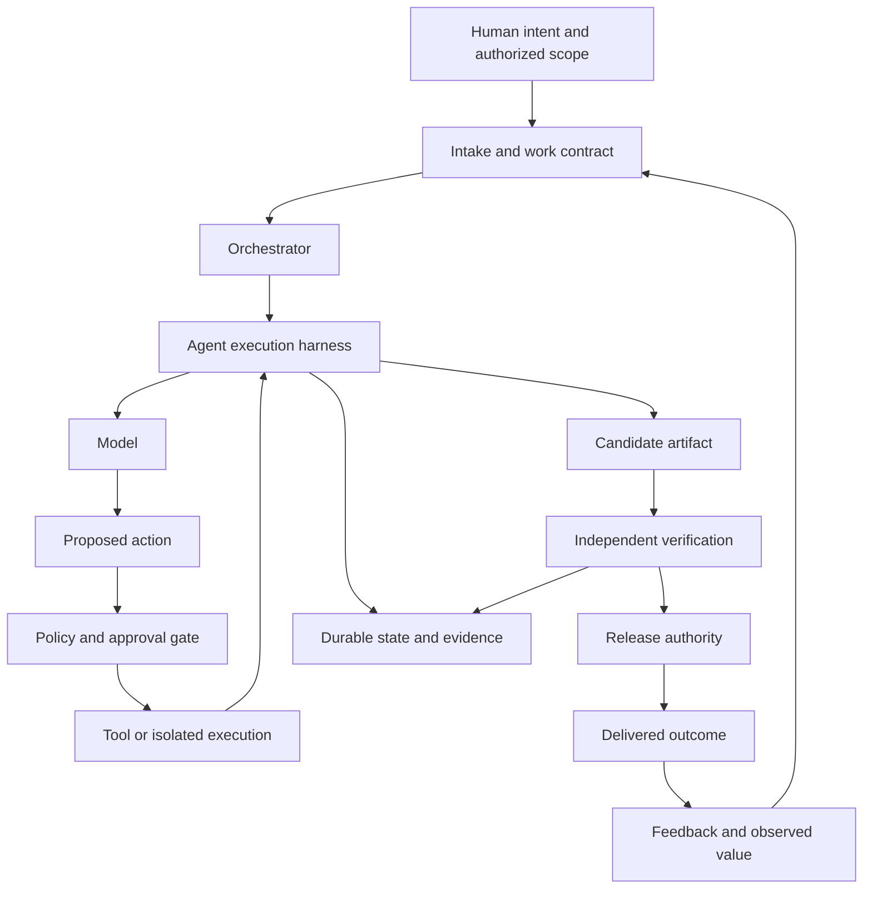

# 01 - Foundations and Concept Map

[Back to the index](README.md)

## Learning objective

Explain the system without using "agent," "harness," and "factory" as interchangeable buzzwords. Identify which component makes a decision, which component performs an action, and which component has authority to accept the result.

## Three meanings of AI factory

| Meaning | Typical input | Typical output | Primary engineering concern |
|---|---|---|---|
| Compute or infrastructure factory | Energy, accelerators, storage, networking, data, models | Training capacity and inference services | Capacity, throughput, latency, utilization, reliability, energy, cost |
| Enterprise AI delivery capability | Business problems, datasets, domain expertise, approved platforms | Operated AI-enabled products and services | Reuse, portfolio selection, governance, lifecycle, organizational ownership |
| Agentic software factory | Intent, specifications, source code, constraints, tools | Verified software changes and release evidence | Repeatable execution, verification, integration, recovery, accountability |

NVIDIA's usage emphasizes infrastructure and coordinated production of AI computation. Enterprise MLOps and AI operating-model guidance emphasize the larger delivery system. StrongDM and Allbright describe software production using agents, although they make different choices about human involvement. [S01](16-sources-and-reading-guide.md#s01) [S02](16-sources-and-reading-guide.md#s02) [S03](16-sources-and-reading-guide.md#s03) [S04](16-sources-and-reading-guide.md#s04) [S42](16-sources-and-reading-guide.md#s42)

There is no single universally accepted "AI factory architecture" that makes these meanings identical. Our working definition is:

> An AI factory is a managed system that repeatedly transforms authorized inputs into useful, evaluated outputs, using AI where it adds value, with explicit ownership and feedback.

This is a **corpus definition**, chosen to make design discussions precise. It is not a standards-body definition.

## Model, application, workflow, and agent

### Model

A language model produces outputs conditioned on inputs and learned parameters. Its learned parameters are not a live database of our project's current state. Its fluent explanation is not proof that an external action occurred.

A model can return text, structured data, or tool-call requests. A tool-call request is a proposed operation represented in a format the surrounding application can interpret. The surrounding system must decide whether to execute it.

### AI application

An application adds interfaces, data access, policy, domain logic, and operating infrastructure around a model. A single model call that classifies an incoming document is an AI application without necessarily being an agent.

### Workflow

A workflow has an explicitly designed control flow: retrieve documents, extract fields, validate them, then route to a reviewer. Some steps may use AI, but the model does not have unrestricted authority to invent the process.

### Agent

An agent uses a model to select actions based on observations while pursuing a goal. It can decide to gather more information, use a different tool, revise a plan, or stop. Its autonomy should still be bounded by application policy and the user's authorized scope.

Anthropic distinguishes predetermined workflows from systems where the model dynamically directs its process and tool use. ReAct is an influential research example of interleaving model reasoning and environmental actions. Neither implies that every application benefits from an open-ended loop. [S06](16-sources-and-reading-guide.md#s06) [S26](16-sources-and-reading-guide.md#s26)

## What a harness is

"Harness" is a borrowed engineering term: the surrounding apparatus that connects a component to inputs, tools, controls, and observation.

| Kind | Purpose | Example responsibilities |
|---|---|---|
| Agent execution harness | Enable and govern a model-driven execution | Context assembly, tool dispatch, permissions, turn limits, state, stopping |
| Evaluation harness | Run controlled tasks and measure behavior | Fixtures, isolation, repeated trials, graders, aggregation |
| Developer environment harness | Make the working environment repeatable and legible | Process startup, terminals, watchers, health checks, local commands |
| Test harness | Supply test inputs and collect test outcomes | Setup, teardown, stubs, assertions, reporting |
| Harness, the company | Commercial software-delivery platform | Product-specific CI/CD and AI-assisted delivery capabilities |

Anthropic explicitly separates agent and evaluation harnesses. EleutherAI's Language Model Evaluation Harness is an example of evaluation infrastructure, not a full software factory. Harness the product is a separate proper noun. [S10](16-sources-and-reading-guide.md#s10) [S37](16-sources-and-reading-guide.md#s37) [S34](16-sources-and-reading-guide.md#s34)

The supplied Allbright article uses "harness" broadly across capability and developer setup. That is useful conversationally, but we will specify the kind when designing interfaces.

## Related building blocks

**Runtime:** the machinery that actually executes the application: processes, event loops, workers, sandboxes, scheduling, and lifecycle. Some products use "runtime" for most of what others call a harness.

**Framework or SDK:** reusable software that implements selected mechanisms. It may provide a loop, tracing, tools, persistence, or delegation. Its presence does not automatically provide our risk policy or acceptance criteria.

**Orchestrator:** the component that coordinates work among steps or workers. It may be deterministic, model-driven, or hybrid.

**Tool:** an operation exposed to the agent. Its interface defines inputs and outputs; its implementation and authorization determine what it can actually do.

**Skill:** a package of procedural guidance and supporting resources. It can explain how to do a task; it is not necessarily a separate process, identity, or agent.

**Persona:** a role description or behavior specialization. Calling a prompt "Architect" does not make it an independent authority.

**Memory:** retained information used across steps or sessions. Memory can be wrong, stale, unauthorized, or irrelevant.

**Context:** the selected information supplied to a model for a particular inference. Context is assembled from instructions, task state, observations, retrieved evidence, and other permitted inputs.

**Environment:** the world the agent observes and changes: files, APIs, browser state, databases, and test fixtures.

## A systems map

The diagram is our synthesis. Some components can live in one process; the logical boundaries still matter.

## Four different kinds of "learning"

1. **In-context adaptation:** the model uses examples or instructions in the current request. Its parameters are not changed.
2. **Persistent external memory:** a later run retrieves a stored lesson or fact. Quality depends on what was stored and whether retrieval is appropriate.
3. **Application improvement:** developers revise prompts, tools, workflows, tests, and policy based on evidence.
4. **Model training or fine-tuning:** an optimization process changes learned parameters.

A team updating a playbook usually performs the second and third activities, not the fourth. Saying an agent "learned our business rules" can conceal this distinction. An edited document does not guarantee that the next run reads it or follows it.

## Control, data, execution, and evidence

These names help organize responsibility, but are not rigid standards for every factory.

- **Control plane:** work definitions, permissions, scheduling decisions, budgets, configuration, and promotion decisions.
- **Execution plane:** workers, model calls, tool invocations, and sandboxes.
- **Data plane:** source material and information moving through the workload.
- **Evidence plane:** records needed to explain and substantiate actions and results.

A source repository can contain code, policy, tests, and documentation; a repository boundary does not by itself define these planes. A separate log repository is not automatically an evidence store with appropriate retention or access control.

## Autonomy is a vector, not one switch

An application can be highly autonomous in reading public documents and tightly restricted in writing to production.

Describe autonomy across separate dimensions:

| Dimension | Example choices |
|---|---|
| Planning | Fixed steps, selectable branches, open-ended planning |
| Tool choice | Fixed operation, allowlisted set, dynamic discovery |
| Data access | Public only, scoped private sources, cross-tenant prohibited |
| Write authority | Draft only, reversible sandbox writes, approved external writes |
| Time horizon | One response, bounded task, resumable long-running work |
| Budget | Per-call, per-run, per-tenant, shared global limits |
| Human control | Preapproval, per-action approval, exception review |
| Deployment | No release access, staged promotion, delegated low-risk release |

One system can occupy different positions in each row. "Fully autonomous" usually hides the actual boundaries.

## When not to use an agent

Use deterministic software when the rule and required input are known. Use a single model call when the task is a bounded transformation. Use a workflow when the sequence is stable. Introduce an agent when choosing the next step from observations is itself a material part of the problem.

For example:

- Renaming a field across a known JSON structure does not require an open-ended agent.
- Extracting clauses from variable documents might benefit from a model plus schema validation.
- Producing a report from fixed sources may fit a deterministic retrieval-and-generation workflow.
- Diagnosing an unfamiliar build failure may benefit from an agent that chooses which evidence to inspect.

The decision is empirical. Compare against a simpler baseline before treating autonomy as an achievement.

## Common category errors

| Incorrect shortcut | More precise statement |
|---|---|
| "We have an LLM, so we have an agent." | A model becomes part of an agent when the application supports goal-directed action and feedback. |
| "We installed an agent framework, so we have a factory." | A factory also needs intake, verification, ownership, lifecycle, and delivery. |
| "The agent said the test passed." | A captured result for the correct revision may support that claim. |
| "The tool schema validates permissions." | Schema validation checks shape; authorization checks authority and scope. |
| "The skill is a specialist worker." | A skill can be instructions loaded by the current worker. |
| "The terminal pane is observable." | It is visible to a human; machine-readable evidence requires an actual capture interface. |
| "The workflow completed." | Completion may mean execution ended, not that the intended outcome was accepted. |

## Check your understanding

Describe a coding assistant using the terms model, harness, environment, tool, evaluation, and factory. Then remove the model from the drawing and ask which responsibilities still exist. Most of the engineering system remains.
