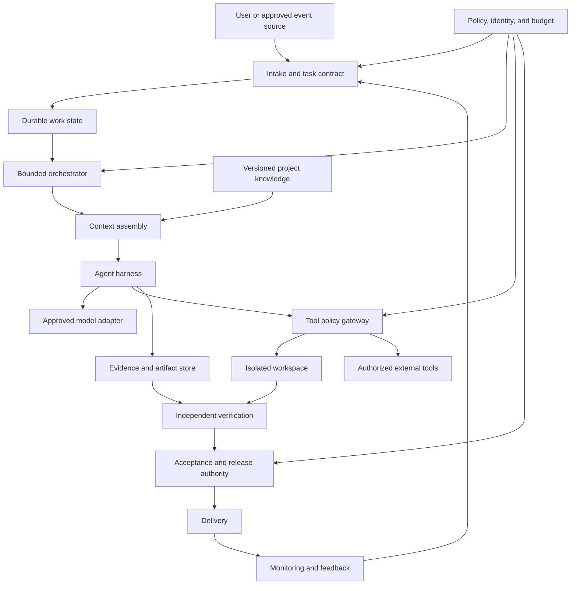

# 12 - Reference Architecture and Design Choices

[Back to the index](README.md)

## Status

This is a **proposed reference model for learning and later design**, not a selected implementation. No service, framework, model, or deployment target has been chosen.

**Publication note:** these statements describe the 2026-11-04 research
baseline, not the current implementation state of the enclosing project.

The goal is a small system whose boundaries remain clear as capabilities grow.

## Logical architecture

Logical boxes do not require separate microservices. A first experiment may implement several inside one process with a local durable store.

## Component contracts

| Component | Owns | Must not silently own |
|---|---|---|
| Intake | Normalization, scope, task identity | Unlimited authority from any incoming text |
| Work state | Status, dependencies, leases, attempts | The truth of generated claims |
| Context assembly | Authorized evidence selection | Permission expansion |
| Harness | Execution lifecycle and tool routing | Acceptance by self-declaration |
| Model adapter | Approved invocation and usage | Unapproved provider fallback |
| Tool gateway | Identity, target validation, side-effect controls | Business decisions absent from policy |
| Workspace | Candidate changes and local execution | Production credentials by default |
| Verification | Tests, graders, evidence interpretation | Rewriting product goals to make results pass |
| Release authority | Promotion under policy | Accepting stale or mismatched evidence |
| Knowledge system | Reviewed reusable context | Turning every run note into permanent truth |

## The smallest useful vertical slice

A reasonable first experiment, once implementation is requested, would be:

- one bounded task class;
- one approved model configuration;
- one isolated workspace;
- a small explicit tool set;
- a versioned task contract;
- a protected evaluation set;
- durable run state and usage;
- no automatic production release;
- a human acceptance decision.

This is not the full factory. It is a test of whether a narrow flow delivers value and whether the proposed boundaries work.

## Candidate implementation approaches

| Approach | Useful when | What to verify |
|---|---|---|
| Direct model API plus a small loop | The flow is narrow and custom control matters | State, tool dispatch, limits, and error semantics are implemented correctly |
| Claude Agent SDK | Claude Code-like tools and agent behavior fit the task | Local runtime, permissions, sessions, hooks, and provider terms |
| OpenAI Agents SDK | Its loop, tools, handoffs, sessions, and tracing fit the task | Actual persistence, approvals, tracing destinations, and sandbox setup |
| LangGraph | Explicit stateful graphs and checkpointed execution are useful | Backend durability, replay behavior, interruption semantics, and schema evolution |
| Existing task runner and CI | Much of the workflow is deterministic | Command portability, failure propagation, and protected promotion |
| Managed agent platform | Operational delegation is valuable and authorized | Data boundaries, credentials, recovery, cost, and exit strategy |
| Commercial delivery platform | Existing enterprise delivery controls are a strong fit | Integration scope, governance behavior, licensing, and measurable benefit |

Relevant official documentation includes the Claude SDK, OpenAI SDK, LangGraph persistence/checkpointers, and Harness AI overview. These are capability references, not comparative performance evidence. [S12](16-sources-and-reading-guide.md#s12) [S13](16-sources-and-reading-guide.md#s13) [S14](16-sources-and-reading-guide.md#s14) [S41](16-sources-and-reading-guide.md#s41) [S34](16-sources-and-reading-guide.md#s34)

## Build versus buy

Evaluate:

1. Which capability differentiates our solution?
2. Which operational responsibilities are we prepared to own?
3. Can the component enforce the required boundaries?
4. Can we export task state, evidence, and artifacts?
5. Are failure modes and version changes understandable?
6. Does the total cost include engineering time and incident response?
7. Can a simpler existing tool satisfy the requirement?

Avoid building a general-purpose orchestration platform just to run one workflow. Also avoid adopting a large platform whose defaults conflict with our data or authority requirements.

## Decisions that should remain open

| Decision | Evidence needed before choosing |
|---|---|
| First use case | Valuable, bounded task with observable acceptance |
| Model/provider | Task-specific quality, cost, and approved data handling |
| Local or hosted execution | Environment needs, reliability, and organizational constraints |
| Persistence backend | Required concurrency, recovery, retention, and backup behavior |
| Retrieval approach | Corpus size, query types, freshness, and measured retrieval quality |
| Number of agents | Ablation showing benefit over a single worker |
| Review model | Risk class, verification strength, and accountable owner |
| Task runner | Existing ecosystem, portability, and maintainability |
| Production release | Explicit authority and demonstrated controls |
| Content-factory expansion | Different acceptance criteria, rights, and publication controls |

The [architecture decision template](templates/architecture-decision-record.md) is designed to record these choices when evidence exists.

## Configuration and reproducibility

A run manifest should identify the exact task, code, prompts, tools, model configuration, policy, evaluation set, and environment.

Use immutable identifiers where practical. When a provider exposes only a mutable alias, record that limitation rather than pretending the run is fully reproducible.

The system should be able to answer: "Which configuration produced this artifact, and which evidence supports this decision?"

## Storage separation

A practical design can distinguish:

- product source and reviewed documentation;
- source datasets and their permissions;
- transient working files;
- durable task state;
- restricted execution evidence;
- promoted artifacts;
- secrets.

These categories may share technology but should not share access and retention blindly.

A separate Git repository is one option for certain reviewable artifacts. It is not automatically appropriate for logs, secrets, large datasets, or regulated records.

## Windows and portable execution

The original research considered a Windows working environment. A future implementation should explicitly choose whether execution is native Windows, WSL, containers, a remote host, or a combination. This publication does not prescribe a machine-specific storage location.

Questions include:

- Which shell executes task commands?
- Are paths and quoting portable?
- Where do databases and long-lived processes live?
- Does the filesystem support the required locking and watcher behavior?
- How are credentials kept out of synchronized documentation?
- Can evidence and state be restored consistently?

Do not assume that a terminal layout or a OneDrive-synchronized folder provides process supervision, transactional storage, or a backup strategy for live databases.

## Suggested implementation sequence

This is a sequence for later work, not authorization to begin it now.

| Phase | Deliverable | Gate to continue |
|---|---|---|
| Define | Charter and task contract | Owner agrees on scope and acceptance |
| Baseline | Manual/deterministic reference | Can measure quality and effort |
| Execute | Bounded single-worker harness | Correct ordinary and negative cases |
| Verify | Protected evaluation and evidence packet | Candidate results are trustworthy enough |
| Recover | Checkpoints and reconciliation | Fault-injection cases pass |
| Operate | Observability, budgets, runbooks | Owners can explain and contain failures |
| Expand | More tasks or reviewers | Measured benefit without boundary regression |
| Delegate release | Narrow preauthorized promotion class | Explicit approval and risk evidence |

## Avoid premature architecture

Do not begin with a swarm, a vector database, a model router, a GPU cluster, and a multi-region deployment because those are common in diagrams.

Begin with the outcome and the evidence. Add a component when it solves a demonstrated constraint. Keep a record of what was deliberately deferred and what evidence would justify revisiting it.
