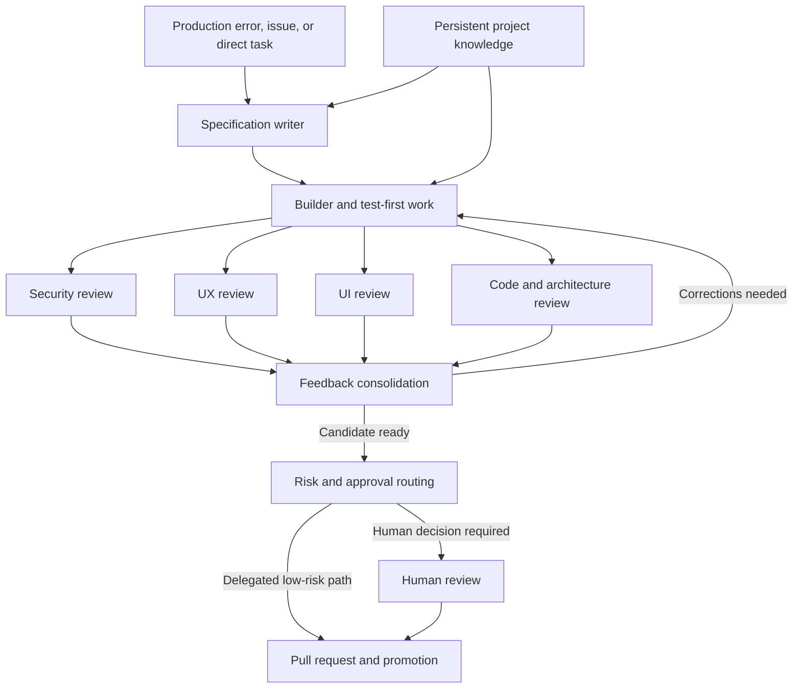

# 20 - Eric Risco Video: From Agents to Software and Content Factories

[Back to the index](README.md)

## Source and review scope

**Original title:** *Programar con agentes ya no basta: monta tu Software Factory* 
**Creator:** Eric Risco | Inteligencia Artificial 
**YouTube date:** October 23, 2026 
**Duration:** approximately 17 minutes 21 seconds 
**User-supplied link:** [video at 14:18](https://www.youtube.com/watch?v=p6nnqerea7w&t=858s) 
**Source IDs:** [S48](16-sources-and-reading-guide.md#s48), with the linked project's documentation separately recorded as [S49](16-sources-and-reading-guide.md#s49).

Review method: read the complete available Spanish auto-generated transcript, from 00:00 through 17:20; inspect the original description and chapter markers; inspect selected frames around 06:40, 10:25, and 14:18. This is a **full-transcript review with selected visual checks**, not continuous listening, a source-code audit, or a reproduction of the demonstrated system.

The English explanations below are original paraphrases. Auto-captions misspell some product names and garble at least one quantitative statement. Those passages are not used as precise evidence.

## Overall assessment

The video's strongest contribution is a clear shift from **interactive assistance** to **a managed flow of work**. A task enters a defined process, uses persistent project knowledge, passes through specialized stages, and produces something reviewable.

Its useful architectural idea is not a specific model lineup. It is the combination of:

- common intake;
- explicit specifications;
- context retained outside a chat;
- bounded implementation;
- focused reviews;
- feedback and rework;
- a separate decision about human involvement;
- traceable work identities.

The critical qualification is that these pieces describe an architecture and a creator's experience. They do not establish measured reliability, universal productivity, or safe unattended deployment.

Near 16:16, the creator explicitly describes the software and content systems as two proofs of concept being developed into a broader RSC Factory. That maturity statement should travel with any summary of the video.

## Timestamped reading map

| Time | What the video discusses | What to learn or question |
|---|---|---|
| [00:00](https://www.youtube.com/watch?v=p6nnqerea7w&t=0s) | Interactive coding can leave the human as the coordination bottleneck | Measure where work actually waits; do not assume all human involvement is waste |
| [01:38](https://www.youtube.com/watch?v=p6nnqerea7w&t=98s) | Factory as repeatable and auditable processing | Define inputs, outputs, stage contracts, and evidence |
| [02:53](https://www.youtube.com/watch?v=p6nnqerea7w&t=173s) | Code steps, agent steps, and human approval steps | Use different mechanisms for different kinds of decisions |
| [04:00](https://www.youtube.com/watch?v=p6nnqerea7w&t=240s) | Persistent project "brain" | Preserve decisions, but also manage freshness, permissions, and conflicts |
| [05:30](https://www.youtube.com/watch?v=p6nnqerea7w&t=330s) | Software-factory example | Separate intake, specification, implementation, and review |
| [06:34](https://www.youtube.com/watch?v=p6nnqerea7w&t=394s) | Production errors, GitHub issues, and direct tasks share an entry point | Normalize inputs without erasing their different trust levels |
| [07:31](https://www.youtube.com/watch?v=p6nnqerea7w&t=451s) | Builder works from the specification and uses test-first development | Generated tests still need independent acceptance coverage |
| [08:12](https://www.youtube.com/watch?v=p6nnqerea7w&t=492s) | Security, UX, UI, and code-consistency reviewers | Specialized reviews can help; four opinions are not four independent proofs |
| [10:14](https://www.youtube.com/watch?v=p6nnqerea7w&t=614s) | An approver consolidates feedback and sends work back | Add bounded iteration, conflict resolution, and reproducible findings |
| [11:03](https://www.youtube.com/watch?v=p6nnqerea7w&t=663s) | A further agent routes low- versus high-risk changes | Risk recommendations must not bypass mandatory policy |
| [12:04](https://www.youtube.com/watch?v=p6nnqerea7w&t=724s) | Hooks or code are needed to block prohibited actions | The video itself recognizes that an agent alone is insufficient enforcement |
| [12:32](https://www.youtube.com/watch?v=p6nnqerea7w&t=752s) | Multiple identified tasks can run in parallel | Add workspace isolation, shared budgets, and integration coordination |
| [13:51](https://www.youtube.com/watch?v=p6nnqerea7w&t=831s) | The pattern extends to content production | Preserve the architecture while changing the verification criteria |
| [14:18](https://www.youtube.com/watch?v=p6nnqerea7w&t=858s) | AI-assisted editing of the current video | This is the supplied timestamp; the surrounding explanation is the content pipeline |
| [15:23](https://www.youtube.com/watch?v=p6nnqerea7w&t=923s) | The creator still reviews and uploads manually | Do not summarize the example as fully autonomous publication |
| [16:16](https://www.youtube.com/watch?v=p6nnqerea7w&t=976s) | Proofs of concept and the proposed RSC Factory | Distinguish current demonstrations, a linked harness, and a future broader product |

Chapter timestamps identify where to revisit the argument; they are not experimental measurements.

## Reconstructing the software workflow

The following is our diagrammatic synthesis of the described process:

The diagram omits implementation details the video does not establish: durable queues, transactional behavior, exact permission enforcement, independent test ownership, and production rollback. Those are design requirements to investigate, not features we should assume exist.

### Common intake

The Sentry/GitHub/task convergence is a useful abstraction. Our implementation would also need deduplication, source identity, severity, affected revision, authorization, and a correlation key.

A production error is evidence of a symptom, not authorization for any repair the model invents. Many alerts can share one root cause; treating every alert as an independent work item can create duplicate or conflicting patches.

### Persistent brain

The example of retaining a database choice illustrates why architecture decisions should survive chats. The stronger formulation is not "memory prevents hallucinations," but:

> Maintained, authoritative, retrievable project knowledge can reduce avoidable errors, provided the agent also checks the actual current system.

A stored PostgreSQL decision can be stale. The application might have migrated, or the task might concern a separate component. Store scope, date, revision, owner, and exceptions.

### Test-first builder

Writing a failing test before the implementation is useful feedback. It does not prove that the test expresses the correct user requirement or covers regressions.

If one agent writes the specification, the test, and the implementation from the same mistaken assumption, all three can agree. Preserve independent acceptance criteria and protected regression checks.

### Four reviewers

The source describes different models and fresh contexts for security, UX, UI, and code consistency. This can create useful specialization, but requires empirical evaluation.

Fresh context reduces conversational contamination; it does not ensure statistical independence. Different model families can still miss the same issue. Security review does not replace authorization controls. UI inspection does not replace accessibility checks or correct backend behavior.

Our review contract should require each finding to name a specific artifact revision, evidence, impact, and a reproduction or trace when feasible. Consolidate duplicates and retain justified disagreements instead of forcing a unanimous narrative.

### Approver versus authorization

The word "approver" covers at least two distinct functions in the video:

1. Assess whether reviewer feedback has been addressed.
2. Decide whether the result needs human approval.

Neither function should silently become unlimited release authority.

A risk-classification agent can recommend a route. Protected rules should force review for classes such as identity, payments, production configuration, data migrations, secrets, and legally consequential content. Uncertain classification should take the more constrained route.

The video explicitly calls for hooks or code around this boundary. Our extension is to require those controls to be outside the worker's ordinary editing authority and to bind approvals to the exact change.

## The content factory at 14:18

The surrounding transcript describes a pipeline that:

1. Receives a raw recording.
2. Removes silences and mistakes.
3. Assembles the remaining material.
4. Adds design elements, animations, and transitions.
5. Prepares assets such as a thumbnail.
6. Leaves final review and upload with the creator.

At 14:18, the selected frame discusses AI-assisted video editing. A model/version label is visible, but that is evidence of what the video presents, not independent evidence of the model's availability, training, or comparative performance.

The content example matters because it separates a **factory pattern** from **software-specific tools**. Code compilation is replaced by media rendering; software tests are replaced or supplemented by continuity, factual, rights, accessibility, and editorial checks.

### Additional verification a content factory needs

| Risk | Example check |
|---|---|
| Editing changes meaning | Compare important statements before and after cuts |
| Generated visual asserts a false fact | Check the visual against the approved script and sources |
| Music or imagery has unsuitable rights | Record license and permitted use |
| Captions are inaccurate | Check names, numbers, technical terminology, and accessibility |
| Personal information remains visible | Review footage and overlays for disclosures |
| Thumbnail misrepresents the content | Editorial approval against the actual video |
| Wrong asset is published | Bind the publication decision to the rendered artifact |
| Publishing retries duplicate a post | Use operation identity and outcome reconciliation |

The creator's manual final upload is a meaningful control. Preserve that fact when learning from the example.

## Claims to qualify rather than repeat

| Claim or implication | Critical reading |
|---|---|
| The whole industry has already moved to factories | Broad adoption claim, not established by this video |
| Code steps are always deterministic | Code can depend on time, concurrency, external state, and failures; deterministic logic still needs controlled conditions |
| Repeatability requires exactly the same path | A governed workflow can branch and remain repeatable at the contract and evidence level |
| Persistent memory solves consistency | Memory helps only if correct, scoped, current, and consulted |
| A sufficiently strong model can safely classify all release risk | Model judgment is fallible; use mandatory policy and escalation |
| A small text or visual edit is low risk | Legal wording, accessibility, pricing, and consent text can be consequential despite small diffs |
| Repeating a task weekly makes it worth automating | Frequency is only one input; include failure cost, verification difficulty, maintenance, and benefit |
| Multiple named reviewers prove quality | Measure defect detection, false positives, correlated misses, latency, and cost |
| Large code or PR volumes demonstrate value | Volume does not establish accepted outcomes, maintainability, or total cost |

These qualifications do not negate the architecture. They make it usable without turning a demonstration into an unsupported production guarantee.

## The linked RSC Harness project

The video's description links to [rsc-harness](https://github.com/ericrisco/rsc-harness). Its current README was read separately; its current content must not be retroactively treated as the exact implementation shown in the video.

The README describes project-local knowledge, skills, working rules, a reviewable onboarding plan, and provider-specific support limits. It also describes Git permissions and knowledge synchronization behavior that would require explicit review before adoption. [S49](16-sources-and-reading-guide.md#s49)

Especially useful questions raised by the documentation:

- Which controls are enforced by hooks, and which are only instructions?
- Which data is automatically synchronized or committed?
- What can the configured assistant push or publish?
- How is a changed installation plan reapproved?
- What happens on Windows when a target uses copies rather than symlinks?
- Does the installed version actually exhibit the documented behavior?

No commands from that README were executed. No RSC components were installed. A README review is not an audit of implementation correctness.

## Comparison with Allbright

| Dimension | Allbright article | Risco video |
|---|---|---|
| Entry point | Shared task registry and work tracker | Common intake for alerts, issues, and requests |
| Execution | Personas within a developer harness | Specification, builder, parallel reviewers, feedback |
| Knowledge | Project playbooks and documentation | Persistent project brain |
| Human role | Delegation, oversight, and review | Risk-routed review; manual final content publication |
| Main strength | Team reproducibility and shared operations | Concrete end-to-end flow and cross-domain reuse |
| Main missing evidence | Measured scaling and complete enforcement design | Measured reliability, failure handling, and safe promotion |

Together, they suggest a useful direction: shared, legible operations feeding a traceable workflow with explicit knowledge, verification, and authority boundaries.

## Lessons for our later design

Borrow the separation of stages, not an unmeasured model lineup. Begin with one task class and one bounded worker. Add specialized reviewers only if they improve a protected evaluation set. Keep the final authorization policy independent of model persuasion. Treat content production as a second domain with its own acceptance criteria, not as software delivery with different filenames.

The first experiment should compare a simple baseline against this richer pipeline, measuring accepted outcome quality, human minutes, total cost, time to acceptance, and recovery behavior. The result should decide which layers we keep.
